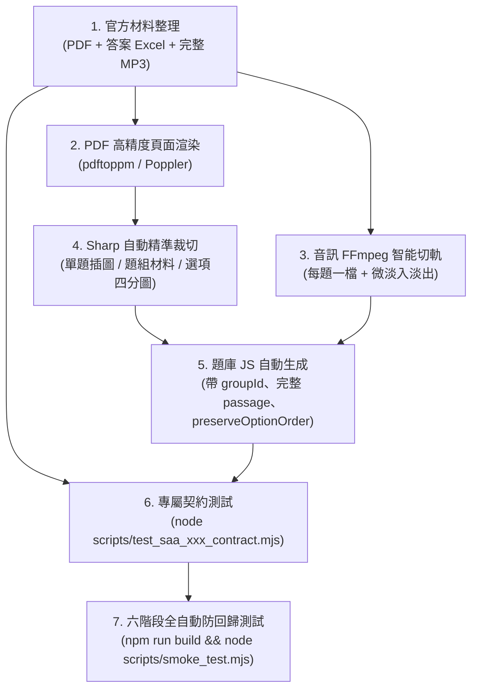

# SAA (教育部學生學習成就評量) 歷年英語檢定標準化截取與規格指南
# SAA Official Exam Extraction & Quality Assurance Standard (Dual-AI Gold Standard)

> **版本**：2.0.0 (融合 ChatGPT 與 Antigravity 實戰經驗之黃金標準規範)  
> **適用範圍**：教育部 SAA 國小四、五、六年級歷年官方全真試卷（113、114、115 年度及未來擴充）  
> **關聯程式碼**：`src/data/exam/saa/`、`src/games/exam/PureMcqExamView.jsx`、`scripts/`

---

## 一、 全域不可妥協之工程鐵律 (Global Guardrails)

1. **三軌精熟與排行榜物理分流**：
   - 官方 SAA 試卷全量題目固定帶有 `track: 'ministry-assessment'`、`sourceType: 'official'`、`sourceStatus: 'published'`。
   - 官方考古題每卷固定 35 題（15 聽力＋20 閱讀），嚴禁混入任何自主研發類題；自主研發題未通過審核前不得進入正式試卷。
   - 學生進行個人「易錯題」混抽複習時，結算必須依題目來源軌道正確歸入 `ministry-assessment`，不得流入課本 `curriculum`。
2. **原卷選項順序與官方答案真實性保護**：
   - SAA 官方原卷選項順序嚴禁洗牌，每題必須帶有 `preserveOptionOrder: true`。
   - 答案索引（`answer: 0~3`）必須精確對照教育部官方公佈之標準答案（A=0, B=1, C=2, D=3），**嚴禁使用課本題庫之統一 `answer: 0` 模式**。
3. **Cloudflare Pages 單檔 25 MiB 上限防護**：
   - 嚴禁把單一 25MB 以上的完整年級聽力 MP3 放進 `public/` 目錄。
   - 必須透過 FFmpeg 切分成每題獨立之小 MP3（每檔約 80～150 KB，96kbps Mono），並配置 `Cache-Control: public, max-age=31536000, immutable`。
4. **題組共用材料單一真實來源 (SSOT)**：
   - 同一題組（例如 Q31～Q33）每題皆必須帶有相同的 `groupId` 與完整的 `passage` 物件（包含 `title`, `text`, `image`）。
   - **嚴禁只在題組第一題保存材料**，否則切題或易錯題複習時材料將遺失。
5. **圖片型選項（Image Options）解耦原則**：
   - 若四個答案本身為插圖，嚴禁合併為 4 合 1 大圖再靠文字描述或人工熱區點擊。
   - 必須拆為獨立四張圖片並對接 `optionImages: [a, b, c, d]`，支援 2×2 大圖卡點卡作答與獨立點擊放大鏡。

---

## 二、 SAA 歷年檢定標準化截取六大步驟 (Extraction SOP)



### 步驟 1：原始官方檔案準備
- 四、五、六年級官方試卷 PDF。
- 官方公佈標準答案 Excel / CSV。
- 官方完整聽力錄音 MP3。

### 步驟 2：PDF 頁面高解析度渲染 (Poppler)
- 輸出命令：
  ```bash
  pdftoppm -jpeg -r 110 "G4_Exam.pdf" tmp/pdfs/{year}/g4
  pdftoppm -jpeg -r 110 "G5_Exam.pdf" tmp/pdfs/{year}/g5
  pdftoppm -jpeg -r 110 "G6_Exam.pdf" tmp/pdfs/{year}/g6
  ```
- **尺寸校準防呆**：基準頁面尺寸為 `910 × 1287 px`。裁切腳本在執行前先讀取圖片真實尺寸，若解析度微差則動態按比例 scale 縮放裁切座標，杜絕跨平台環境座標偏移。

### 步驟 3：官方聽力音檔 FFmpeg 智能切檔
- 以時間戳記設定檔驅動切分，參數標準化為：
  ```bash
  ffmpeg -y -ss {startTime} -to {endTime} -i full.mp3 \
    -af "afade=t=in:ss=0:d=0.1,afade=t=out:st={duration-0.1}:d=0.1" \
    -c:a libmp3lame -b:a 96k -ar 44100 -ac 1 \
    public/audio/saa/{year}/g{grade}/q{num}.mp3
  ```
- **防爆音與緩衝規範**：起訖點加入 0.1s 淡入淡出濾鏡；前導預留 0.3s、結尾預留 0.6s 靜音緩衝。

### 步驟 4：Sharp 自動圖片裁切
- **單題插圖**：只裁切作答必要插圖，外擴 12～16px 白邊，不帶題號與頁碼，WebP q92。
- **題組共用材料**：長文、時刻表或地圖輸出至 `public/assets/exam/saa/{year}/materials/`。
- **圖片型選項**：拆為獨立四張 WebP：`_a.webp`、`_b.webp`、`_c.webp`、`_d.webp`。

### 步驟 5：題庫資料結構生成 (`src/data/exam/saa/`)
每年級固定 35 題，Q1～15 聽力，Q16～35 閱讀：
```javascript
{
  id: 'saa-114-g4-08',
  year: 114,
  grade: 4,
  targetGrade: 4,
  book: 4,
  unit: '114 年國小四年級學力檢測',
  section: 'listening',
  track: 'ministry-assessment',
  sourceType: 'official',
  sourceStatus: 'published',
  preserveOptionOrder: true,
  reviewed: true,
  number: 8,
  taskType: 'L-SENT',
  dimension: '辨識句意',
  question: '請聽對話，選出最相符的收據圖片：',
  options: ['(A)', '(B)', '(C)', '(D)'],
  optionImages: [
    '/assets/exam/saa/114/options/g4_q8_a.webp',
    '/assets/exam/saa/114/options/g4_q8_b.webp',
    '/assets/exam/saa/114/options/g4_q8_c.webp',
    '/assets/exam/saa/114/options/g4_q8_d.webp'
  ],
  answer: 1,
  media: {
    audioSrc: '/audio/saa/114/g4/q08.mp3',
    audioText: '...',
    audioSourceType: 'official'
  },
  explanation: '...'
}
```

### 步驟 6：專屬合約自動化驗證 (`test_saa_xxx_contract.mjs`)
每個建置年度均需配備獨立的合約測試腳本，驗證：
1. 35 × 3 = 105 題。
2. Q1～15 聽力、Q16～35 閱讀。
3. `sourceType: 'official'`、`track: 'ministry-assessment'`、`preserveOptionOrder: true`。
4. 4 個選項且答案為 0～3。
5. 聽力題目絕不在題幹洩漏逐字稿。
6. 題組題目共用 100% 相同之 `passage` 物件。
7. 所有引用的圖片與音檔路徑全數存在於 `public/`。

---

## 三、 SAA 現有已建置年度狀態一覽表

| 年度 | 題數 | 聽力/閱讀 | 題組數 (子題數) | 圖片素材 | 官方音檔 | 合約測試 | 狀態判定 |
| :---: | :---: | :---: | :---: | :---: | :---: | :---: | :---: |
| **115 年度** | 105 題 | 15 聽 + 20 讀 | 7 組 (17 題) | 70 張 WebP | TTS 備援 | `smoke_test.mjs` [0/6] | ✅ 全面通過 |
| **114 年度** | 105 題 | 15 聽 + 20 讀 | 7 組 (17 題) | 35 單題圖 + 144 選項圖 (`optionImages`) | TTS 備援 / `build_114_saa_audio.mjs` 就緒 | `test_saa_114_contract.mjs` (8 大門禁) | ✅ **黃金標準（結構校準 + 選項解耦）全面通過** |
| **113 年度** | 105 題 | 15 聽 + 20 讀 | 題組獨立材料 | 完整材料 WebP | 45 檔官方原聲 | `test_saa_113_contract.mjs` | ⚡ ChatGPT 實作就緒 |

---

## 四、 常用驗證指令

```bash
# 1. 執行 SAA 114 專屬官方契約驗證
node scripts/test_saa_114_contract.mjs

# 2. 執行全域靜態契約與 6 階段防回歸測試 (含 14 款遊戲 × 4 身分全量矩陣)
npm run build && node scripts/smoke_test.mjs
```
