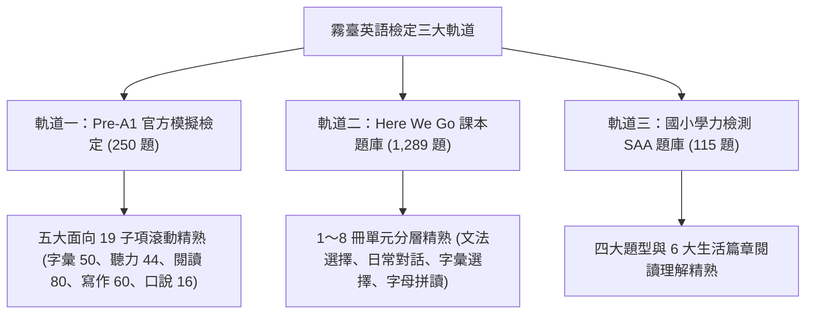
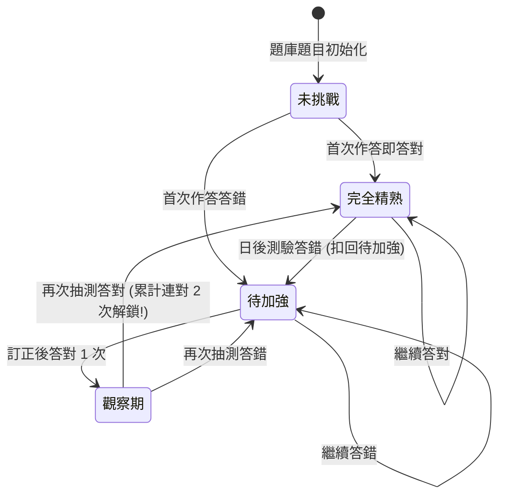
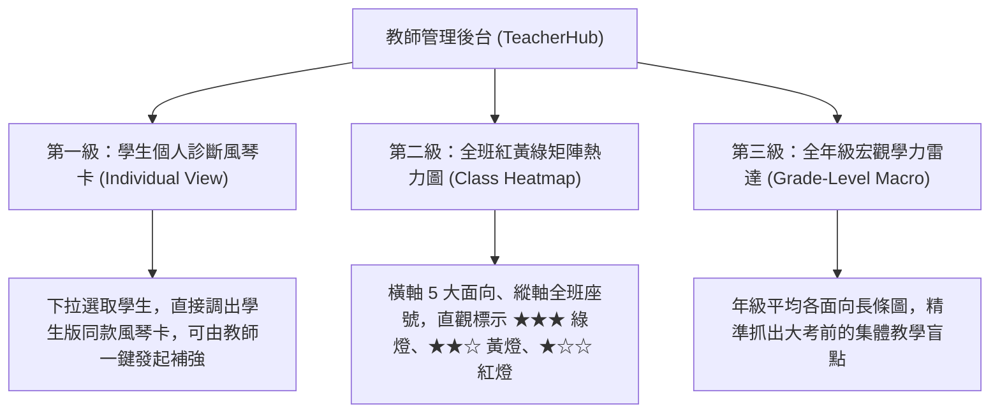

# 霧臺國小三大英語檢定軌道「動態滾動精熟體系」與「四大天王排行榜」總體架構規劃書
# (The Definitive Blueprint for Three Exam Tracks Mastery Engine & Four Champions Leaderboard)

> **文件定位**：本規格書由霧臺國小英語教育團隊與系統工程師共同制定，為全系統最高指導原則。本手冊清楚規範三大檢定軌道（Pre-A1 官方模擬、課本題庫、學力檢測）之**「動態滾動精熟演算法」**、**「學生端 iPad 一頁式風琴折診斷卡」**、**「教師端三級檢視管理台」**、**「四大天王排行榜（測驗王、金幣王、積分王、遊戲王）」**與**「正式施測模式」**，確保系統兼顧科學測驗效度、正向成長動機與現場教學實務。

---

## 壹、 核心願景與教學指導哲學 (Core Pedagogical Principles)

### 1. 拒絕「歷史懲罰效應 (Historical Penalty Effect)」
- **傳統盲點**：單純以 $\frac{\text{累計答對次數}}{\text{累計做過次數}}$ 計算答對率，會讓前期學習較慢、錯題較多的孩子永遠背負過去的污點，即使後期 100 題全對也只能逼近 99%，**永遠拿不到 100% 滿分金牌**，嚴重打擊低成就學生的學習動機。
- **現代教育哲學**：測驗旨在衡量學生**「現在的真實能力（Current Competence）」**，而非懲罰他過去不會時的歷史錯誤。只要學生弄懂並精熟，系統必須賦予他達到 **100% 完全精熟** 的正向成長路徑。

### 2. 建立「成長型思維 (Growth Mindset)」之滾動精熟機制
- 允許犯錯、鼓勵訂正、重測翻盤。
- 四選一猜對機率為 $25\%$；但**「錯題連對 2 次」**之連續猜對機率僅為 $25\% \times 25\% = 6.25\%$。在心理計量學上足以確認學生已擺脫瞎猜、真正融會貫通。

### 3. 「學術檢定立國」：確立四大天王主從次序
- 課本、學力、Pre-A1 官方模擬是全校英語教學的**核心主戰場**。
- 貪食蛇、打地鼠、隕石等遊戲僅為課間引起動機的輔助工具，絕不可喧賓奪主。

---

## 貳、 三大英語檢定軌道規格與精熟度判定演算法 (Mastery Engine)



### 1. 滾動精熟狀態機演算法 (Rolling Mastery State Machine)

每位學生針對題庫中的每道題目 $Q_i$（以 `question.id` 為鍵值），系統維護其動態學習狀態：

| 狀態代碼 | 狀態名稱 | 定義規準 | 轉換至下一狀態之條件 |
| :---: | :--- | :--- | :--- |
| `unattempted` | ⚪ **未挑戰** | 學生從未在測驗中遇過該題 | 答對 $\to$ `mastered`；答錯 $\to$ `remedial` |
| `mastered` | 🟢 **完全精熟** | 學生目前已確實掌握該題 | 繼續答對 $\to$ 維持 `mastered`；<br/>若日後答錯 $\to$ 降級退回 `remedial` |
| `remedial` | 🔴 **待加強** | 學生最近一次答錯此題 | 訂正後首次答對 $\to$ `probation`；<br/>若再答錯 $\to$ 維持 `remedial` |
| `probation` | 🟡 **觀察考驗期** | 錯題後首次答對（需再過一關） | **再次答對（累計連對 2 次）$\to$ 翻盤解鎖 `mastered`**；<br/>若答錯 $\to$ 降回 `remedial` |



### 2. 精熟度百分比與星級計算公式（杜絕投機漏洞）
為避免「題庫 14 題只做 2 題全對就顯示 100%」之偏誤：
- **子題型精熟度公式**：
  $$\text{Mastery Rate} = \frac{\sum [狀態為 \text{mastered} 的題目數]}{\text{該子題型在題庫中之總試題數 } N_{\text{total}}} \times 100\%$$
- **星級與三色燈門檻**：
  - 🟢 **★★★ 精熟金星**：$\text{Mastery Rate} \ge 80\%$
  - 🟡 **★★☆ 掌握銀星**：$60\% \le \text{Mastery Rate} < 80\%$
  - 🔴 **★☆☆ 加強紅星**：$0\% < \text{Mastery Rate} < 60\%$
  - ⚪ **☆☆☆ 尚未挑戰**：作答題數 $< 3$ 題（標註「點擊開始挑戰」）

---

## 參、 學生端：iPad 一頁式風琴折診斷卡與專項特訓 (Student Edition)

### 1. iPad 螢幕最佳化：風琴折佈局 (Accordion View)
為保證學生在 iPad 橫向或直向使用時**完全免滾動（Zero-Scroll）**即可一覽全貌：

```
┌─────────────────────────────────────────────────────────────┐
│ 👤 林小宇 (四年甲班 01 號)       [全部 (預設)] [僅正式測驗]   │
│ 🏆 Pre-A1 總精熟：218 / 250 題 (87%) ★★★ 綠燈   [僅限半年內] │
├─────────────────────────────────────────────────────────────┤
│ 🔤 【字彙專項】 45 / 50 題精熟 (90%) ★★★       [▼ 展開細項] │
├─────────────────────────────────────────────────────────────┤
│ 🎧 【聽力專項】 38 / 44 題精熟 (86%) ★★★       [▼ 展開細項] │
├─────────────────────────────────────────────────────────────┤
│ 📖 【閱讀專項】 68 / 80 題精熟 (85%) ★★★       [▼ 展開細項] │
├─────────────────────────────────────────────────────────────┤
│ ✍️ 【寫作專項】 52 / 60 題精熟 (86%) ★★★       [▼ 展開細項] │
├─────────────────────────────────────────────────────────────┤
│ 🎙️ 【口說專項】 15 / 16 題精熟 (93%) ★★★       [▼ 展開細項] │
└─────────────────────────────────────────────────────────────┘
```

#### 點擊展開風琴折（以聽力為例）：
展開後平滑滑出該大類所屬之所有子項目，每項均具備獨立進度與一鍵補強：
- 🎧 **看圖選句**：`12 / 12 題 (100%) ★★★ 綠燈` ｜ *(累計挑戰 18 次)* ｜ **[🎯 複習 5 題]**
- 🎧 **聽對話選圖**：`10 / 12 題 (83%) ★★★ 綠燈` ｜ *(累計挑戰 15 次)* ｜ **[🎯 專項特訓 5 題]**
- 🎧 **選正確回應**：`6 / 10 題 (60%) ★★☆ 黃燈` ｜ *(累計挑戰 9 次)* ｜ **[🎯 專項特訓 5 題]**
- 🎧 **聽對話答題**：`5 / 10 題 (50%) ★☆☆ 紅燈` ｜ *(累計挑戰 8 次)* ｜ **[🔥 弱點突擊 5 題]**

### 2. 零新介面的一鍵【🎯 專項特訓 5 題】無痛連動
- **無縫複用現有測驗核心**：
  點擊「專項特訓 5 題」按鈕，系統直接呼叫：
  ```javascript
  startExamSession(subTypePool, 5);
  ```
- **抽題演算法強化**：
  1. 優先抽取狀態為 `remedial`（待加強）與 `probation`（觀察期連對第 2 次考驗）之題目。
  2. 若無錯題，優先抽取 `unattempted`（未曾挑戰過）之全新題目。
  3. 全數做完後才自全池隨機抽樣複習。
- **作答回饋與即時結算**：
  5 題作答完畢，立即顯示小結算卡，並即時將本次對錯刷新回學生個人診斷卡中，**紅色當場有機會衝上金色**！

---

## 肆、 教師端：TeacherHub 三級全方位檢視與控台 (Teacher Edition)

教師後台（TeacherHub）新增【Pre-A1 與學力診斷中心】，提供三層級透視：



### 1. 第二級：全班紅黃綠矩陣熱力圖 (Class Heatmap Matrix)
最受班導師歡迎的教學工具：

| 座號與姓名 | 🔤 字彙面向 (50題) | 🎧 聽力面向 (44題) | 📖 閱讀面向 (80題) | ✍️ 寫作面向 (60題) | 🎙️ 口說面向 (16題) | 總體診斷評語 |
| :---: | :---: | :---: | :---: | :---: | :---: | :--- |
| **01 林小宇** | 🟢 90% ★★★ | 🟢 86% ★★★ | 🟢 85% ★★★ | 🟢 86% ★★★ | 🟢 93% ★★★ | 🏆 全面精熟，免課後輔導 |
| **02 李小華** | 🟢 82% ★★★ | 🟡 68% ★★☆ | 🔴 52% ★☆☆ | 🟡 65% ★★☆ | 🟢 88% ★★★ | ⚠️ 閱讀短文填空需加強 |
| **03 張小豪** | 🔴 48% ★☆☆ | 🔴 45% ★☆☆ | 🔴 50% ★☆☆ | 🔴 40% ★☆☆ | 🟡 62% ★★☆ | 🚨 需安排課後一對一補救 |
| **全班平均** | **78%** | **71%** | **65%** | **72%** | **84%** | **全班待加強：閱讀篇章理解** |

- **一鍵匯出**：支援將全班診斷報表匯出為 CSV 或列印成績單。

### 2. 正式施測模式規範 (Formal Exam Mode Controller)
- **試卷標準**：標準 30 題（聽力 15 題 ＋ 閱讀 15 題），限時 35 分鐘倒數。
- **標準雙次播音協議 (Double Playback Protocol)**：
  - 第 1 次播放 $\to$ 靜音 3 秒提示音 $\to$ 第 2 次播放 $\to$ 進入 10 秒作答倒數。
  - 正式模式下**停用手動無限次重播按鈕**，以反映學生即時語音處理能力。
- **紀錄標記**：完成後紀錄打上 `is_formal: true` 旗標。

---

## 伍、 四大天王全校榮譽排行榜 (The Four Grand Champions Leaderboard)

排行榜頂部劃分為極致工整的「四大天王」大膠囊標籤，徹底解決舊版排行榜雜亂問題：

```
┌─────────────────────────────────────────────────────────────┐
│  [ 👑 測驗王 (預設) ]   [ 🪙 金幣王 ]   [ 🧭 積分王 ]   [ 🎮 遊戲王 ]  │
└─────────────────────────────────────────────────────────────┘
```

### 1. 👑【測驗王】（最核心優先，學術實力殿堂）
- **頂層主榜：三合一精熟總星榜（課本 ＋ 學力 ＋ Pre-A1 總星數）**
  - 表彰三大檢定全面發展的學生（滿分 45 顆星，看誰摘下最多金星！）。
- **風琴折收合展開（三大獨立軌道）**：
  1. **Pre-A1 官方模擬精熟榜**（五類通算 250 題滾動精熟數，如 `235 / 250 題 (94%) 🏆`）
  2. **Pre-A1 勤學刷題榜**（Pre-A1 累計做題總數，表彰汗水付出）
  3. **課本題庫檢定進度榜**（Here We Go 1～8 冊單元通關率）
  4. **國小學力檢測榜**（SAA 篇章閱讀理解得分率）

### 2. 🪙【金幣王】（全域努力與活躍汗水結晶）
- 依據學生在全系統中賺取的**累積總金幣**排名。
- 只要肯做題、肯過關，積少成多，是肯努力的孩子最有成就感的舞台。

### 3. 🧭【積分王】（語境探索與任務對話先鋒）
- 依據學生在霧臺家園村莊探險、NPC 英語對話、故事任務推進獲得的**總探索積分**排名。
- 代表校園互動活躍度。

### 4. 🎮【遊戲王】（休閒競技與操作手速）
- **頂層主榜**：全遊戲綜合總勝場 / 總得分。
- **風琴折下拉各款遊戲子榜**：
  - 叢林貪食蛇、3D 隕石防衛、歡樂打地鼠、字母迷宮、密室逃脫、星際翻牌...
- **優勢**：14 款遊戲各自歸位，首頁不再被小遊戲淹沒！

---

## 陸、 系統工程架構與資料安全守則 (Engineering & Data Guardrails)

### 1. 學生資料永久保護鐵律 (Rule 1 Compliance)
- 嚴格遵守 `AGENTS.md` 第一條守則：**嚴禁覆蓋或清空學生金幣、積分與測驗歷史**。
- 採用 **雙軌聯集融合（Union Merge）**：
  - `localStorage`：記錄本機最新作答明細快照 `wutai_prea1_mastery_${studentId}`（斷線或離線皆可極速呈現）。
  - `Supabase`：雲端異步同步，以 `Math.max` 取最高精熟題數與累積題數，整學期保留。

### 2. 學生答題明細資料結構 Schema
```typescript
interface StudentMasterySnapshot {
  student_id: string;
  updated_at: string; // ISO 8601
  tracks: {
    'tme-preA1': {
      total_items: 250;
      mastered_count: number;
      attempted_count: number;
      categories: {
        vocab: { total: 50; mastered: number; attempted: number };
        listening: { total: 44; mastered: number; attempted: number };
        reading: { total: 80; mastered: number; attempted: number };
        writing: { total: 60; mastered: number; attempted: number };
        speaking: { total: 16; mastered: number; attempted: number };
      };
      items: {
        [questionId: string]: {
          status: 'unattempted' | 'mastered' | 'remedial' | 'probation';
          consecutive_correct: number;
          last_attempt_at: string;
          is_formal: boolean;
        };
      };
    };
  };
}
```

---

## 柒、 分階段實作推進排程 (Implementation Roadmap)

| 階段代號 | 任務主體與交付成果 | 涉及檔案路徑 | 驗證標準 |
| :---: | :--- | :--- | :--- |
| **Phase 1** | **動態滾動精熟核心計算模組**<br/>實作狀態機切換、連對 2 次判定、星級與進度計算函式 | `src/utils/masteryHelper.js`<br/>`scripts/test_mastery_engine.mjs` | 單元測試 100% 通過（含猜對防禦、狀態翻盤與退回） |
| **Phase 2** | **學生端 iPad 風琴折答題診斷卡 ＋ 專項特訓**<br/>5 大面向風琴折、酷英三星色塊、一鍵 5 題專項突擊 | `src/components/exam/PreA1MasteryDashboard.jsx`<br/>`src/games/exam/PureMcqExamView.jsx` | iPad 首頁無滾動、點擊專項特訓秒開 5 題測驗並即時回刷 |
| **Phase 3** | **四大天王排行榜重構**<br/>頂部 4 大標籤（測驗王、金幣王、積分王、遊戲王），收折子榜 | `src/components/LeaderboardView.jsx` | 介面清爽無雜訊、三合一總榜與 Pre-A1 總精熟正確連動 |
| **Phase 4** | **教師端三級檢視矩陣**<br/>個人風琴卡、全班紅黃綠矩陣熱力圖、年級宏觀雷達 | `src/components/TeacherHub.jsx`<br/>`src/components/exam/ExamAuditZone.jsx` | 教師登入即刻調閱全班紅黃綠色塊，一眼抓出待補救名單 |
| **Phase 5** | **正式施測雙次播音與 35 分鐘倒數模式**<br/>聽力標準 2 次播放、讀題緩衝倒數、正式卷標籤 | `src/games/exam/PureMcqExamView.jsx`<br/>`src/games/exam/examBlueprint.js` | 聽力每題標準播放 2 次、交卷後正確打上 `is_formal: true` |
| **Phase 6** | **全專案 6 階段無頭 Chrome 回歸測試與正式上線**<br/>全量矩陣驗證、Cloudflare Pages 生產發布 | 全專案 | 6 大階段 100% 通過，0 Crashes，推送到 `origin/main` |
