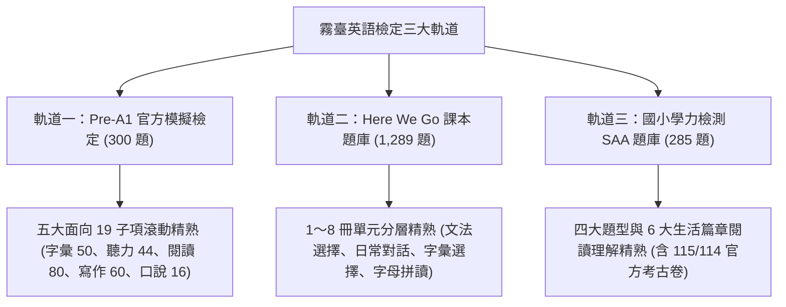
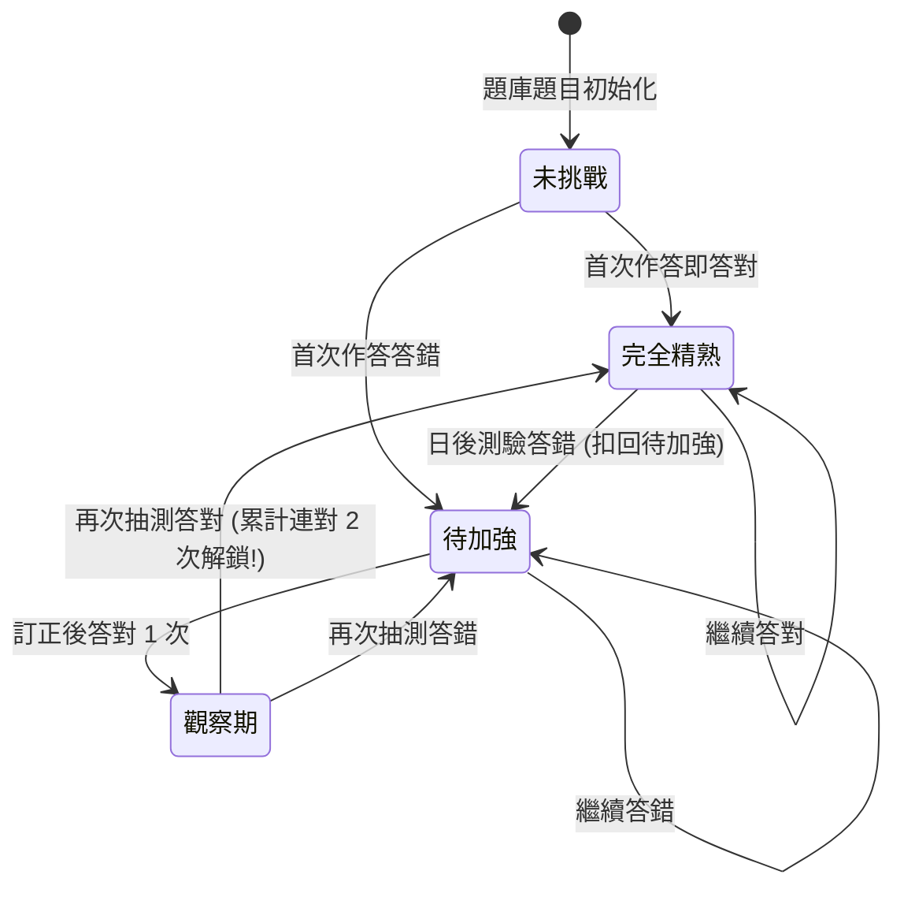
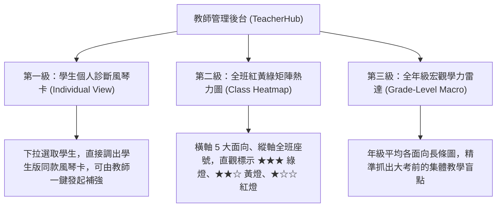

# 霧臺國小三大英語檢定軌道「動態滾動精熟體系」與「四大天王排行榜」總體架構規劃書
# (The Definitive Blueprint for Three Exam Tracks Mastery Engine & Four Champions Leaderboard)

> **文件定位**：本規格書由霧臺國小英語教育團隊與系統工程師共同制定，為全系統最高指導原則。本手冊清楚規範三大檢定軌道（Pre-A1 官方模擬、課本題庫、學力檢測）之**「動態滾動精熟演算法」**、**「學生端 iPad 一頁式風琴折診斷卡」**、**「教師端三級檢視管理台」**、**「四大天王排行榜（測驗王、金幣王、積分王、遊戲王）」**與**「正式施測模式」**，確保系統兼顧科學測驗效度、正向成長動機與現場教學實務。

---

## 壹、 核心願景與教學指導哲學 (Core Pedagogical Principles)

### 1. 拒絕「歷史懲罰效應 (Historical Penalty Effect)」
- **傳統盲點**：單純以 $\frac{\text{累計答對次數}}{\text{累計做過次數}}$ 計算答對率，會讓前期學習較慢、錯題較多的孩子永遠背負過去的污點，即使後期 100 題全對也只能逼近 99%，**永遠拿不到 100% 滿分金牌**，嚴重打擊低成就學生的學習動機。
- **現代教育哲學**：測驗旨在衡量學生**「現在的真實能力（Current Competence）」**，而非懲罰他過去不會時的歷史錯誤。只要學生弄懂並精熟，系統必須賦予他達到 **100% 完全精熟** 的正向成長路徑。

### 2. 建立「成長型思維 (Growth Mindset)」之滾動精熟機制
- 允許犯錯、鼓勵訂正、重測翻盤。
- 四選一猜對機率為 $25\%$；但**「錯題連對 2 次」**之連續猜對機率僅為 $25\% \times 25\% = 6.25\%$。在心理計量學上足以確認學生已擺脫瞎猜、真正融會貫通。

### 3. 「學術檢定立國」：確立四大天王主從次序
- 課本、學力、Pre-A1 官方模擬是全校英語教學的**核心主戰場**。
- 貪食蛇、打地鼠、隕石等遊戲僅為課間引起動機的輔助工具，絕不可喧賓奪主。

---

## 貳、 三大英語檢定軌道規格與精熟度判定演算法 (Mastery Engine)



### 1. 滾動精熟狀態機演算法 (Rolling Mastery State Machine)

每位學生針對題庫中的每道題目 $Q_i$（以 `question.id` 為鍵值），系統維護其動態學習狀態：

| 狀態代碼 | 狀態名稱 | 定義規準 | 轉換至下一狀態之條件 |
| :---: | :--- | :--- | :--- |
| `unattempted` | ⚪ **未挑戰** | 學生從未在測驗中遇過該題 | 答對 $\to$ `mastered`；答錯 $\to$ `remedial` |
| `mastered` | 🟢 **完全精熟** | 學生目前已確實掌握該題 | 繼續答對 $\to$ 維持 `mastered`；<br/>若日後答錯 $\to$ 降級退回 `remedial` |
| `remedial` | 🔴 **待加強** | 學生最近一次答錯此題 | 訂正後首次答對 $\to$ `probation`；<br/>若再答錯 $\to$ 維持 `remedial` |
| `probation` | 🟡 **觀察考驗期** | 錯題後首次答對（需再過一關） | **再次答對（累計連對 2 次）$\to$ 翻盤解鎖 `mastered`**；<br/>若答錯 $\to$ 降回 `remedial` |



### 2. 精熟度星級、開拓度五階莫蘭迪底色與精準柵格排版規範

為兼顧「作答品質（答對率）」與「開拓深度（涵蓋率）」，系統全面採取「雙軌分流呈現」與「固定槽柵格佈局」：

#### (1) 品質指標：3D 立體金星列（以學生已挑戰題目計算實質精熟率）
- 學生個人精熟率：$\text{Mastery Rate} = \frac{\text{已精熟題數 (mastered)}}{\text{已挑戰題數 (attempted)}} \times 100\%$
- **< 50% 答對率**：0 顆星（未起評/加強中，留白乾淨，移除廉價 emoji）
- **50% ~ 69% 答對率**：1 顆 3D 立體金星（基礎及格）
- **70% ~ 89% 答對率**：2 顆 3D 立體金星（良等熟練）
- **90% ~ 99% 答對率**：3 顆 3D 立體金星（優等精熟）
- **100% 滿分全對**：3 顆 3D 立體金星 ＋ **滿分流光特效（45° 金屬光斜掃 ＋ 金色呼吸外光暈 ＋ ✨ 滿分標籤）**

#### (2) 開拓指標：莫蘭迪五階底色（以全卷總題數為分母）
- 題庫開拓率：$\text{Coverage Rate} = \frac{\text{已挑戰題數 (attempted)}}{\text{題庫總題數 (total)}} \times 100\%$
- **< 50% 開拓率**：莫蘭迪淡霧灰 (Mist Gray) - 採樣起步
- **50% ~ 69% 開拓率**：莫蘭迪淡燕麥棕 (Oat Brown) - 初探開拓
- **70% ~ 79% 開拓率**：莫蘭迪淡鼠尾草綠 (Sage Green) - 熟練深造
- **80% ~ 89% 開拓率**：莫蘭迪淡霧霾藍 (Haze Blue) - 黃金廣博
- **≥ 90% 開拓率**：莫蘭迪淡香檳暖金 (Champagne Gold) - 宗師全通

#### (3) 子題型細項排版：固定三星欄 ＋ 固定雙槽行動格 (Zero-Layout-Shift Grid)
- **🖥️ 桌機與平板視圖 (sm 以上，精準三欄水平對齊)**：
  - **欄 1 (資訊欄，自適應伸展)**：子題型標題 ＋ 莫蘭迪開拓標籤 ＋ 說明文字。
  - **欄 2 (固定三星欄，寬度 125px)**：3 顆立體金星等距佔位（靠左排列）＋ 精熟率文字，上下行零抖動、精準垂直對齊。
  - **欄 3 (固定雙槽行動格，寬度 184px)**：
    - **左槽 (Slot 1, 88px)**：若有未精熟錯題且未達 100% 滿分，顯示「🔥 錯題 (N)」按鈕（及時翻盤）；無錯題時留白佔位維持寬度。
    - **右槽 (Slot 2, 88px)**：若該子題型有未挑戰之新題，顯示「✨ 新題 (M)」按鈕；無新題時留白佔位。
    - 若既無錯題亦無新題（100% 滿分全通），雙槽均為純淨空白，展現滿星成就感。
- **📱 手機端極簡緊湊視圖 (sm 以下，高自適應零空槽)**：
  - **第一列**：標題 ＋ 莫蘭迪開拓標籤 ── 靠右對齊立體星與百分比。
  - **第二列**：子題型說明 ── 僅渲染實際存在的行動按鈕晶片（🔥 錯題 N、✨ 新題 M 或 ✓ 全數精熟），不渲染任何空白佔位框，高空間利用率且點擊流暢！

---

## 參、 學生端：iPad 一頁式風琴折診斷卡與專項特訓 (Student Edition)

### 1. iPad 螢幕最佳化：風琴折佈局與三大測驗獨立色彩分流 (Accordion View & 3 Distinct Palettes)

為兼顧三大測驗（Pre-A1 官方模擬、SAA 學力檢測、課本單元進度）各自獨立的架構特性，學生精熟診斷一覽表提供**頂部三大軌道切換標籤**，並賦予強烈且具辨識度的**三原創主題色系**，杜絕視覺混淆：

| 測驗軌道 | 總題數 | 主視覺調性與漸層 | 題庫結構特色 |
| :--- | :---: | :--- | :--- |
| **📘 Test My English Pre-A1 官方模擬** | **300 題** | **湛藍星空 ＋ 科技靛藍 (`Sky / Indigo / Navy / Gold`)**<br/>`from-indigo-600 via-sky-600 to-indigo-700` | 五大官方素養面向 × 19 種生活子題型，CEFR Pre-A1 認證標準 |
| **📗 教育部 SAA 學力成就檢測** | **285 題**<br/>*(115年 105題 ＋ 114年 105題 ＋ 常規模擬 75題)* | **翡翠山林 ＋ 鼠尾草綠 (`Emerald / Teal / Mint`)**<br/>`from-emerald-700 via-teal-600 to-emerald-800` | 聽力三大題 (句意、問答、言談) ＋ 閱讀二大題 (單題、生活題組)；支援 115 與 114 全真切換 |
| **📙 翰林課本單元進度檢定** | **1,289 題** | **活力琥珀 ＋ 珊瑚暖橙 (`Amber / Orange / Coral`)**<br/>`from-amber-600 via-orange-600 to-amber-700` | Here We Go 1～8 冊、字母專冊與國一銜接先修，同步段考 |

```
┌─────────────────────────────────────────────────────────────┐
│ 👤 林小宇 (四年甲班 01 號)       [全部 (預設)] [僅正式測驗]   │
│ [📘 Pre-A1 模擬 (300)] [📗 SAA 學力 (285)] [📙 課本進度 (1289)] │
│ 🏆 Pre-A1 總精熟：268 / 300 題 (89%) ★★★ 綠燈   [僅限半年內] │
├─────────────────────────────────────────────────────────────┤
│ 🔤 【字彙專項】 50 / 56 題精熟 (89%) ★★★       [▼ 展開細項] │
├─────────────────────────────────────────────────────────────┤
│ 🎧 【聽力專項】 52 / 60 題精熟 (87%) ★★★       [▼ 展開細項] │
├─────────────────────────────────────────────────────────────┤
│ 📖 【閱讀專項】 78 / 88 題精熟 (89%) ★★★       [▼ 展開細項] │
├─────────────────────────────────────────────────────────────┤
│ ✍️ 【寫作專項】 54 / 60 題精熟 (90%) ★★★       [▼ 展開細項] │
├─────────────────────────────────────────────────────────────┤
│ 🎙️ 【口說專項】 34 / 36 題精熟 (94%) ★★★       [▼ 展開細項] │
└─────────────────────────────────────────────────────────────┘
```

#### 點擊展開風琴折（子題型細項之固定三星欄 ＋ 雙槽行動格）：
展開後平滑滑出該大類所屬之所有子項目，桌面端採用嚴格等寬水平柵格排版，絕無任何佈局跳動（Zero Layout Shift）：
- 🎧 **看圖選句**：`開拓 12/12 (100%)` ｜ ★★★ 滿分流光 (100%) ｜ `[  留白佔位  ]` `[  留白佔位  ]` *(全數精熟)*
- 🎧 **聽對話選圖**：`開拓 10/12 (83%)` ｜ ★★☆ 精熟 80% (8/10) ｜ `[🔥 錯題 (2)]` `[✨ 新題 (2)]`
- 🎧 **選正確回應**：`開拓 18/18 (100%)` ｜ ★★☆ 精熟 83% (15/18) ｜ `[🔥 錯題 (3)]` `[  留白佔位  ]`
- 🎧 **聽對話答題**：`開拓 0/18 (0%)` ｜ 未起評 尚未挑戰 ｜ `[  留白佔位  ]` `[✨ 新題 (18)]`

### 2. 固定雙槽行動格【🔥 錯題速測】與【✨ 新題速測】抽題機制
- **左槽 (Slot 1, 88px)：🔥 錯題速測**：
  - 專供學生**及時自我訓練翻盤**。
  - 精準從該子題型之 `remedial`（待加強）與 `probation`（連對 1 次考驗期）錯題池抽題。
  - 5 題快速衝刺，只要連對 2 次立即原地翻盤解鎖為完全精熟！
- **右槽 (Slot 2, 88px)：✨ 新題速測**：
  - 專供學生**開拓未知領域**。
  - 精準從題庫中該子題型學生尚未挑戰過之全新試題 (`!items[q.id]`) 隨機抽樣。
  - 開拓度指標（莫蘭迪灰棕綠藍金）隨新題攻克立即由灰轉棕、由棕轉綠、直奔金牌！
- **雙槽留白規範**：
  - 若已達 100% 滿分流光無任何錯題，左槽為純淨透明留白（`invisible pointer-events-none`）。
  - 若新題已全部挑戰完畢，右槽為純淨透明留白。
  - 兩槽均為留白時，呈現「全數精熟」之大圓滿成就感，且全表格左右絕對垂直對齊！

### 3. SAA 學力測驗 114 年全真考古題入庫成果與規格手冊
- **三大測驗題數平衡現狀**：
  1. 📙 **課本進度檢定**：1,289 題（涵蓋 Here We Go 1～8 冊全冊）。
  2. 📘 **Pre-A1 官方模擬**：300 題（五大素養面向、19 種子題型完整建置）。
  3. 📗 **教育部 SAA 學力成就**：**285 題**（115 年度 105 題 ＋ 114 年度 105 題 ＋ 常態模擬題 75 題）。
- **114 年學力測驗全真試卷入庫清單 (臺中教育大學 SAA 114 年國小英語檢測)**：
  - **四年級 (G4)**：35 題（Q1-Q10 辨識句意、Q11-Q15 言談理解、Q16-Q25 單題文法字彙、Q26-Q35 篇章理解，含 Q31-Q33 視訊通話、Q34-Q35 驚喜派對題組）。
  - **五年級 (G5)**：35 題（Q1-Q10 辨識句意、Q11-Q15 言談理解含火車廣播、Q16-Q25 單題、Q26-Q35 篇章理解，含 Q31-Q33 週日計畫、Q34-Q35 每週課表題組）。
  - **六年級 (G6)**：35 題（Q1-Q10 辨識句意、Q11-Q15 言談理解、Q16-Q25 單題、Q26-Q35 篇章理解，含 Q31-Q33 沙發評論、Q34-Q35 Toby 日記題組）。
- **四大工程與教學規範保證**：
  1. **圖像高解析預留邊距裁切 (Padding)**：62 張 WebP 圖檔向非空白區域多預留 20~40px 邊距，絕不貼邊切傷文字、題號或圖表外框。
  2. **題組整組包裹防破碎 (Passage Bundling)**：每道題組賦予唯一 `groupId`（如 `saa-114-g4-call`、`saa-114-g5-schedule`），並將全篇 `passage` 文本/圖表注入每題，保證隨機抽題時整捆抽取、不破碎。
  3. **聽力多角色語音分流 (Multi-character American Voices)**：使用 Whisper 精準轉錄聽力文本，男女老少角色分流（`Mom: ... \n Boy: ...`），嚴格強制美式英語 (`en-US`) 優先，杜絕法語/葡語音色混入。
  4. **全真考古題選項真實性**：官方考古題 100% 保持官方原始 3~4 個選項與官方公佈答案，不額外新增干擾選項。
  5. **年度試卷切換支援**：檢定館（`PureMcqExamView`）支援 115 年度最新卷與 114 年度正式題本即時切換。

---

## 肆、 教師端：TeacherHub 三級全方位檢視與控台 (Teacher Edition)

教師後台（TeacherHub）新增【Pre-A1 與學力診斷中心】，提供三層級透視：



### 1. 第二級：全班紅黃綠矩陣熱力圖 (Class Heatmap Matrix)
最受班導師歡迎的教學工具：

| 座號與姓名 | 🔤 字彙面向 (50題) | 🎧 聽力面向 (44題) | 📖 閱讀面向 (80題) | ✍️ 寫作面向 (60題) | 🎙️ 口說面向 (16題) | 總體診斷評語 |
| :---: | :---: | :---: | :---: | :---: | :---: | :--- |
| **01 林小宇** | 🟢 90% ★★★ | 🟢 86% ★★★ | 🟢 85% ★★★ | 🟢 86% ★★★ | 🟢 93% ★★★ | 🏆 全面精熟，免課後輔導 |
| **02 李小華** | 🟢 82% ★★★ | 🟡 68% ★★☆ | 🔴 52% ★☆☆ | 🟡 65% ★★☆ | 🟢 88% ★★★ | ⚠️ 閱讀短文填空需加強 |
| **03 張小豪** | 🔴 48% ★☆☆ | 🔴 45% ★☆☆ | 🔴 50% ★☆☆ | 🔴 40% ★☆☆ | 🟡 62% ★★☆ | 🚨 需安排課後一對一補救 |
| **全班平均** | **78%** | **71%** | **65%** | **72%** | **84%** | **全班待加強：閱讀篇章理解** |

- **一鍵匯出**：支援將全班診斷報表匯出為 CSV 或列印成績單。

### 2. 正式施測模式規範 (Formal Exam Mode Controller)
- **試卷標準**：標準 30 題（聽力 15 題 ＋ 閱讀 15 題），限時 35 分鐘倒數。
- **標準雙次播音協議 (Double Playback Protocol)**：
  - 第 1 次播放 $\to$ 靜音 3 秒提示音 $\to$ 第 2 次播放 $\to$ 進入 10 秒作答倒數。
  - 正式模式下**停用手動無限次重播按鈕**，以反映學生即時語音處理能力。
- **紀錄標記**：完成後紀錄打上 `is_formal: true` 旗標。

---

## 伍、 大武山四聯屏風畫四大天王榮譽榜與全能至尊殿堂 (Dawu Mountain Polyptych Leaderboard & Grand Master Hall)

全新排行榜徹底剔除廉價 emoji 與多餘文字說明，導入 3A 遊戲級視覺體系：

```
┌──────────────────────────────────────────────────────────────────────────────────┐
│  極簡年級膠囊：[ 一年級 ] [ 二年級 ] [ 三年級 ] [ 四年級 ] [ 五年級 ] [ 六年級 ] [ 全校大亂鬥 ]  │
│  純箭頭週次步進器：[ ◀ 第 10 週 ▶ ]                                                │
│  四王綜合全能至尊殿堂 (Grand Master)：🥇 0401 杜小美  🥈 0402 柯小華  🥉 0405 林小宇         │
└──────────────────────────────────────────────────────────────────────────────────┘
┌──────────────────────────────────────────────────────────────────────────────────┐
│             大武山四聯屏風畫 (Dawu Mountain Polyptych Folding Screen)               │
│  [ 測驗之巔・破曉藍調 ]  [ 金幣之麓・朝陽暖金 ]  [ 積分之谷・林谷翡翠 ]  [ 遊戲之界・暮色紫霞 ] │
│  (西麓起點稜線 y:95-55) (北大武最高主峰 y:55-68) (鞍部巨木深壑 y:68-48) (南大武夕照霞稜 y:48-95)│
│  🥇 0401 杜小美       🥇 0403 王小明       🥇 0402 柯小華       🥇 0407 潘小捷      │
│  🥈 0402 柯小華       🥈 0401 杜小美       🥈 0405 林小宇       🥈 0403 王小明      │
│  🥉 0405 林小宇       🥉 0406 尤小玲       🥉 0404 陳大同       🥉 0401 杜小美      │
│  [ 展開完整榮譽榜 ↗ ]  [ 展開完整榮譽榜 ↗ ]  [ 展開完整榮譽榜 ↗ ]  [ 展開完整榮譽榜 ↗ ] │
└──────────────────────────────────────────────────────────────────────────────────┘
```

### 1. 🏆【四王綜合全能至尊殿堂 (Grand Master Hall)】
- **名次平均計算法（零數字雜訊）**：
  $$\text{GrandMaster Rank} = \frac{\text{Rank}_{exam} + \text{Rank}_{coin} + \text{Rank}_{point} + \text{Rank}_{game}}{4}$$
- 系統內部以毫秒級計算平均名次，但**畫面上絕不呈現混亂的分數數字**，純粹呈現「立體金屬名次徽章 ＋ 學生座號姓名」，極簡尊榮。

### 2. 👑【測驗之王神殿 (Exam Sanctum)】（破曉天青藍調）
- **四大子榜膠囊切換（框色嚴格參考原測驗館）**：
  1. 📘 **Pre-A1 官方精熟** (`border-sky-400 text-sky-300`)：劍橋官方 300 題動態精熟數。
  2. 📗 **SAA 學力成就** (`border-emerald-400 text-emerald-300`)：教育部學力評量 285 題精熟數。
  3. 📙 **課本單元檢定** (`border-amber-400 text-amber-300`)：Here We Go 1,289 題課綱單元測驗。
  4. 🎙️ **雙語口說評測** (`border-rose-400 text-rose-300`)：AI 朗讀跟讀與發音評測完成題數。

### 3. 🪙【金幣之王神殿 (Coin Sanctum)】（朝陽琥珀流金）
- 框色：燦金琥珀 (`border-amber-400/60 shadow-amber-500/25`)。
- 全校金幣富豪 Top 50，直觀體現勤學累積的總資產財富。

### 4. 🧭【積分之谷神殿 (Quest Sanctum)】（林谷雲杉翡翠）
- 框色：山林翡翠 (`border-emerald-400/60 shadow-emerald-500/25`)。
- 霧臺家園探索歷險積分 Top 50，表彰在地文化探索與英語 NPC 互動先鋒。

### 5. 🎮【遊戲之王神殿 (Game Sanctum)】（暮色電競紫霞）
- **100% 嚴格遵照 Lobby.jsx 原單字館四大分類與框色**：
  1. 🧭 **探索解謎 (Explore)** (`border-teal-400 text-teal-300`)：神祕密室逃脫、鷹眼神探找不同、字母巡航迷宮、翻牌記憶對決。
  2. ⚡ **極速反應 (Speed)** (`border-amber-400 text-amber-300`)：單字打地鼠、極速是非滑牌、3D 隕石防衛戰、叢林神山貪蛇。
  3. 📖 **經典測驗 (Quiz)** (`border-sky-400 text-sky-300`)：中英字義速辨、聽力三合一、單字積木拼裝、神筆筆順書寫。
  4. ⚔️ **多人連線 (Battle)** (`border-purple-400 text-purple-300`)：即時多人連線對戰勝場榜。

### 6. 震撼且順暢的收折展開體驗
- **一頁式大武山連峰幾何**：四扇屏風在桌面上一列排開，SVG 山脈稜線在接縫處高度完全重合（y:55, y:68, y:48），合為連綿的大武山畫卷。
- **神殿展開**：點擊任一屏風，鏡頭以 `scale(0.98) -> scale(1)` 搭配專屬色彩環境光暈推入該神殿，頂部展開「微縮四屏風標籤條」，可隨時一鍵切換或「返回大武全景」。
- **極致防呆與防回歸**：無任何廉價 emoji，姓名超長自動 `truncate` 截斷，完全相容於 Stage 0~6 全自動煙測。

---

## 陸、 系統工程架構與資料安全守則 (Engineering & Data Guardrails)

### 1. 學生資料永久保護鐵律 (Rule 1 Compliance)
- 嚴格遵守 `AGENTS.md` 第一條守則：**嚴禁覆蓋或清空學生金幣、積分與測驗歷史**。
- 採用 **雙軌聯集融合（Union Merge）**：
  - `localStorage`：記錄本機最新作答明細快照 `wutai_prea1_mastery_${studentId}`（斷線或離線皆可極速呈現）。
  - `Supabase`：雲端異步同步，以 `Math.max` 取最高精熟題數與累積題數，整學期保留。

### 2. 學生答題明細資料結構 Schema
```typescript
interface StudentMasterySnapshot {
  student_id: string;
  updated_at: string; // ISO 8601
  tracks: {
    'tme-preA1': {
      total_items: 250;
      mastered_count: number;
      attempted_count: number;
      categories: {
        vocab: { total: 50; mastered: number; attempted: number };
        listening: { total: 44; mastered: number; attempted: number };
        reading: { total: 80; mastered: number; attempted: number };
        writing: { total: 60; mastered: number; attempted: number };
        speaking: { total: 16; mastered: number; attempted: number };
      };
      items: {
        [questionId: string]: {
          status: 'unattempted' | 'mastered' | 'remedial' | 'probation';
          consecutive_correct: number;
          last_attempt_at: string;
          is_formal: boolean;
        };
      };
    };
  };
}
```

---

## 柒、 分階段實作推進排程 (Implementation Roadmap)

| 階段代號 | 任務主體與交付成果 | 涉及檔案路徑 | 驗證標準 |
| :---: | :--- | :--- | :--- |
| **Phase 1** | **動態滾動精熟核心計算模組**<br/>實作狀態機切換、連對 2 次判定、星級與進度計算函式 | `src/utils/masteryHelper.js`<br/>`scripts/test_mastery_engine.mjs` | 單元測試 100% 通過（含猜對防禦、狀態翻盤與退回） |
| **Phase 2** | **學生端 iPad 風琴折答題診斷卡 ＋ 專項特訓**<br/>5 大面向風琴折、酷英三星色塊、一鍵 5 題專項突擊 | `src/components/exam/PreA1MasteryDashboard.jsx`<br/>`src/games/exam/PureMcqExamView.jsx` | iPad 首頁無滾動、點擊專項特訓秒開 5 題測驗並即時回刷 |
| **Phase 3** | **四大天王排行榜重構**<br/>頂部 4 大標籤（測驗王、金幣王、積分王、遊戲王），收折子榜 | `src/components/LeaderboardView.jsx` | 介面清爽無雜訊、三合一總榜與 Pre-A1 總精熟正確連動 |
| **Phase 4** | **教師端三級檢視矩陣**<br/>個人風琴卡、全班紅黃綠矩陣熱力圖、年級宏觀雷達 | `src/components/TeacherHub.jsx`<br/>`src/components/exam/ExamAuditZone.jsx` | 教師登入即刻調閱全班紅黃綠色塊，一眼抓出待補救名單 |
| **Phase 5** | **正式施測雙次播音與 35 分鐘倒數模式**<br/>聽力標準 2 次播放、讀題緩衝倒數、正式卷標籤 | `src/games/exam/PureMcqExamView.jsx`<br/>`src/games/exam/examBlueprint.js` | 聽力每題標準播放 2 次、交卷後正確打上 `is_formal: true` |
| **Phase 6** | **全專案 6 階段無頭 Chrome 回歸測試與正式上線**<br/>全量矩陣驗證、Cloudflare Pages 生產發布 | 全專案 | 6 大階段 100% 通過，0 Crashes，推送到 `origin/main` |
