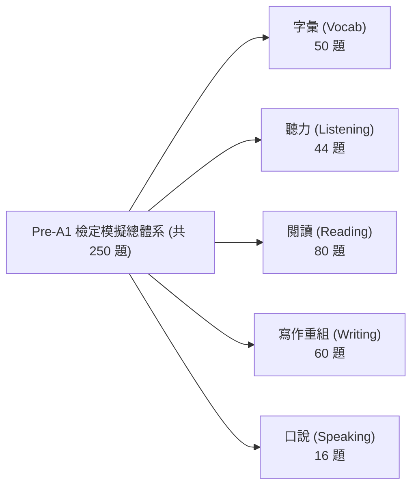

# Test My English Pre-A1 官方模擬測驗完整實戰備考指引與命題規格書
# (The Definitive Teacher & Student Pre-A1 Exam Handbook)

> **文件定位**：本手冊由霧臺國小教學團隊持續增補（Living Document），隨題庫擴充同步更新。旨在讓第一次接觸教育部「Test My English」Pre-A1 檢定的教師與學生，能清楚掌握檢定架構、能力指標邊界、考法題型、解題核心思維與經典類題精解，省去日後重新回顧全量題庫之成本。

---

## 一、 Pre-A1 測驗整體架構與核心指標 (Overview & Blueprint)

教育部「英語能力檢測平台」(Test My English) Pre-A1 級別係參照 CEFR 歐洲語言共同架構之 Pre-A1（約對應劍橋少兒英語 Cambridge YLE Starters 級別），為國小中低年級奠定英語初階能力之標準化測驗。



### 1. 測驗標準規格
- **正式模擬試卷**：30 題（聽力 15 題 ＋ 閱讀 15 題）。
- **作答時間**：35 分鐘。
- **合格門檻**：答對 21 題（得分率 $\ge 70\%$）。
- **專題特訓模式**：各面向 10 題 / 20 題模組化強化（聽力專項、閱讀專項、寫作句子重組專項）。

---

## 二、 五大能力面向題型代碼與命題思維

| 能力面向 | 官方子題型 | 題型代碼 | 命題哲學與評量目標 |
| :--- | :--- | :--- | :--- |
| **字彙 (Vocab)** | 看字選圖 / 看圖選字 / 聽音選圖 / 聽音選字 | `V-PIC`, `V-WORD` | 建立「聲音 ↔ 字母拼寫 ↔ 具象線稿語意」三位一體之直覺反射。 |
| **聽力 (Listening)** | 看圖選句 / 聽對話選圖 / 選正確回應 / 聽對話答題 | `L-SENT`, `L-DLG`, `L-RESP`, `L-CONV` | 評量生活日常問候、指令理解、場景關鍵字捕捉與語用回應（Pragmatics）。 |
| **閱讀 (Reading)** | 看圖選字 / 看圖選句 / 是非判斷 / 段落填空 | `R-TF`, `R-CLOZE`, `R-PASSAGE` | 評量生活短句理解、日常告示配合、短篇生活敘述（Diary, Notice, Invitation）之脈絡填空。 |
| **寫作 (Writing)** | 句子重組（答句重組 / 問句重組） | `W-SCRAMBLE` | 聚焦國小第 1～8 冊核心十大句型，透過立體磁吸積木手感理解語序（Word Order）與助動詞/be動詞配置。 |
| **口說 (Speaking)** | 單字朗讀 / 短句朗讀 / 長句朗讀 | `S-READ` | 評量自然發音連音、語調起伏、常見生活短語朗讀之流暢度。 |

---

## 三、 寫作專項：國小核心十大句型手冊 (Writing Scramble Master Guide)

本系統獨創之「彩色立體磁吸單字積木架 (3D Magnetic Word Blocks Rack)」，將抽象的文法重組轉化為具象的蒙特梭利式積木操作。以下為本題庫 60 題所涵蓋之十大核心句型解題心法：

### 句型 1：Wh- 疑問句型 (Wh- Questions)
- **結構通式**：`Wh-疑問詞 + be動詞 / 助動詞 + 主詞 + (動詞原形) ... ?`
- **常見疑問詞**：
  - `What`（事物、時間 `What time`、顏色 `What color`）
  - `Where`（地點空間）
  - `Who`（人物身分）
  - `How`（問候狀況、天氣 `How is the weather`、年齡 `How old`、數量 `How many`、價格 `How much`）
- **學生常見盲點**：容易漏掉 be 動詞或與主詞顛倒（如寫成 *What your name is?*）。
- **代表性類題試題**：
  - *題目*：看回答「My name is Leo.」，重組問句。
  - *給定字卡*：`is` / `name` / `your` / `What`
  - *標準解法*：疑問詞 `What` 放句首大寫 $\to$ 接 be 動詞 `is` $\to$ 所有格名詞 `your name` $\to$ 句末問號 `?`。
  - *正解*：`What is your name?`

---

### 句型 2：Be 動詞肯定句與否定句 (Be-verb Statements & Negatives)
- **結構通式**：
  - 肯定：`主詞 + am / is / are + 名詞 / 形容詞 / 介系詞片語 .`
  - 否定：`主詞 + am / is / are + not + 名詞 / 形容詞 / 介系詞片語 .`
- **主詞動詞一致性 (Subject-Verb Agreement)**：
  - `I` 搭配 `am`
  - `He / She / It / 單數名詞` 搭配 `is`
  - `We / You / They / 複數名詞` 搭配 `are`
- **代表性類題試題**：
  - *題目*：重組否定句「他不是醫生」。
  - *給定字卡*：`doctor` / `not` / `is` / `a` / `He`
  - *正解*：`He is not a doctor.`

---

### 句型 3：Be 動詞 Yes/No 問句與簡答 (Be-verb Yes/No Questions)
- **結構通式**：
  - 問句：`Am / Is / Are + 主詞 + 補語 ... ?`
  - 答句：`Yes, 主詞 + be動詞 .` / `No, 主詞 + be動詞 + not .`
- **核心思維**：被問 `Are you...?` 時，第一人稱回答轉為 `Yes, I am.`，切勿機械式照抄 `you are`。
- **代表性類題試題**：
  - *題目*：看回答「Yes, I am.」，重組問句。
  - *給定字卡*：`new` / `Are` / `student` / `you` / `a`
  - *正解*：`Are you a new student?`

---

### 句型 4：情態助動詞 Can 肯定、否定與疑問句 (Modal Verb Can)
- **結構通式**：
  - 肯定：`主詞 + can + 原形動詞 ... .`
  - 否定：`主詞 + cannot (can't) + 原形動詞 ... .`
  - 疑問：`Can + 主詞 + 原形動詞 ... ?`
- **核心思維**：`can` 後方**一律接動詞原形**，不受第三人稱單數加 `s` 影響；樂器前加 `the`（`play the piano`），球類前不加 `the`（`play basketball`）。
- **代表性類題試題**：
  - *題目*：重組肯定句「她會彈鋼琴」。
  - *給定字卡*：`piano` / `can` / `play` / `the` / `She`
  - *正解*：`She can play the piano.`

---

### 句型 5：喜好助動詞 Do/Does 句型 (Preferences with Like)
- **結構通式**：
  - 問句：`Do / Does + 主詞 + like + 受詞 ... ?`
  - 肯定：`主詞 + like / likes + 受詞 .`
  - 否定：`主詞 + do not / does not + like + 受詞 .`
- **核心思維**：遇到第三人稱單數時，疑問句使用 `Does`，動詞必須**打回原形 like**；否定句使用 `does not like`。
- **代表性類題試題**：
  - *題目*：看回答「No, she likes milk.」，重組問句。
  - *給定字卡*：`orange` / `juice` / `she` / `Does` / `like`
  - *正解*：`Does she like orange juice?`

---

### 句型 6：需求與想要句型 (Needs & Desires - Want / Need)
- **結構通式**：
  - `主詞 + want(s) + 名詞 / to + 原形動詞 ... .`
  - `What do you want for + 餐別?`
- **核心思維**：多個形容詞修飾同一名詞時，排序原則為「新舊 (new) 先於 顏色 (yellow)」$\to$ `a new yellow doll`。
- **代表性類題試題**：
  - *題目*：重組點餐禮貌句「請給我一個漢堡」。
  - *給定字卡*：`hamburger` / `a` / `please` / `want` / `I`
  - *正解*：`I want a hamburger, please.`

---

### 句型 7：方位介系詞句型 (Prepositions of Place)
- **四大核心介系詞**：
  - `in`（在內部，如 `in the pencil case`）
  - `on`（在表面上，如 `on the desk`）
  - `under`（在正下方，如 `under the chair`）
  - `next to`（在隔壁、相鄰，如 `next to the hospital`）
- **代表性類題試題**：
  - *題目*：看問句「Where is my ruler?」，重組答句。
  - *給定字卡*：`desk` / `is` / `on` / `It` / `big` / `the`
  - *正解*：`It is on the big desk.`

---

### 句型 8：現在進行式句型 (Present Continuous - be + V-ing)
- **結構通式**：
  - 肯定：`主詞 + am / is / are + V-ing + 受詞 / 地方片語 .`
  - 問句：`What + are / is + 主詞 + doing (right now)?`
- **代表性類題試題**：
  - *題目*：重組進行式「女孩正在房間裡聽音樂」。
  - *給定字卡*：`room` / `listening` / `her` / `music` / `in` / `She` / `is` / `to`
  - *正解*：`She is listening to music in her room.`

---

### 句型 9：存在句與數量句型 (There is/are & How many)
- **結構通式**：
  - 單數存在：`There is + a / an + 單數名詞 + 地方片語 .`
  - 複數存在：`There are + 複數名詞 / 數量詞 + 地方片語 .`
  - 數量問句：`How many + 複數名詞 + do you have?`
- **代表性類題試題**：
  - *題目*：重組存在句「大樹上有三隻鳥」。
  - *給定字卡*：`tree` / `birds` / `three` / `big` / `are` / `in` / `There` / `the`
  - *正解*：`There are three birds in the big tree.`（注意：英文習慣「鳥在樹枝間築巢棲息」使用介系詞 `in the tree`）

---

### 句型 10：祈使句與提議句型 (Imperatives & Suggestions)
- **結構通式**：
  - 提議句：`Let's + 原形動詞 + (受詞) + (副詞/副詞片語) .`
  - 肯定祈使句：`(Please) + 原形動詞 + 受詞 + (, please) .`
  - 否定祈使句：`Do not (Don't) + 原形動詞 + ... .`
- **代表性類題試題**：
  - *題目*：重組提議句「放學後我們一起去打籃球吧」。
  - *給定字卡*：`school` / `play` / `after` / `basketball` / `Let's`
  - *正解*：`Let's play basketball after school.`

---

## 四、 閱讀專項：生活情境短文題型與篇章填空解題心法 (Reading Master Guide)

本系統閱讀題庫擴充至 **68 題**，全面涵蓋教育部國小 1～8 冊高頻詞彙與常見真實情境。以下解構五大閱讀子面向、非重點超綱字註解規範與核心破題策略：

### 1. 閱讀能力指標與五大子題型架構 (68 題全量)

| 子題型代碼 | 官方題型名稱 | 題數 | 評量目標與題型特徵 |
| :--- | :--- | :--- | :--- |
| `read-pic2word` (V-PIC) | 看圖選字 | 8 題 | 生活場所、文具、教室設備等具象線稿與單字直覺對應。 |
| `read-pic2sent` (G-CTX) | 看圖選句 | 8 題 | 結合進行式、存在句與主詞動作之生活情境整句理解。 |
| `read-truefalse` (R-TF) | 是非判斷 | 10 題 | 2～3 句微型短文之資訊對照與真偽辨識（True / False）。 |
| `read-cloze` (R-CLOZE) | 段落填空 | 18 題 | 具備完整脈絡的生活短文（40～60 字），依動詞搭配與語意選出正確名詞/形容詞。 |
| `read-passage` (R-COMP) | 篇章閱讀理解 | 24 題 | 6 大生活篇章（每篇 4 題組題）：涵蓋霧臺山林生活、校園失物招領告示、生日邀請函、寵物日記、晨間好習慣、四季天氣。 |

---

### 2. 嚴謹課綱範圍與文末星號 (*) 註解規範 (Footnote Policy)

本系統閱讀篇章命題嚴守三大原則：
1. **核心骨幹嚴守課綱**：句型與主體單字 100% 來自國小英語 1～8 冊核心詞庫（家庭、學校、動物、食物、日常作息、方位與顏色）。
2. **非核心情境超綱字文末附註**：為豐富文章真實感（如告示格式、部落文化），篇章中出現之少數非核心單字，**一律於文末以星號 (*) 提供清晰繁體中文註解**，例如：
   ```text
   * stone slab house: 石板屋
   * boiled millet cake: 水煮小米糕
   * lost and found: 失物招領
   * invitation: 邀請函
   * strawberry: 草莓
   * fever: 發燒
   ```
3. **消除應考恐慌**：學生在答題時可隨時參照文末註解，評量重心回歸「閱讀理解與資訊擷取」本質，而非背誦罕見生詞。

---

### 3. 短文填空 (Cloze) 破題三部曲

短文填空考驗學生在微型語境中提取正確詞彙的能力，指導學生依照以下「三部曲」作答：

- **第一步：看動詞與固定搭配 (Collocation)**：
  - 空格前若有 `drinks a glass of ____`，空格必為可飲用液體（如 `milk`, `water`），直接排除固體食物或文具。
  - 空格前若有 `play the ____`，後接樂器（如 `piano`）；若為 `play ____` 不加 the，後接球類（如 `basketball`）。
  - 空格前若有 `brush your ____`，固定搭配為牙齒（`teeth`）。
- **第二步：看冠詞與單複數 (Article & Number)**：
  - 空格前有 `an ____`，表示答案必須為**母音發音開頭之單數名詞**（如 `umbrella`, `apple`, `eraser`），子音開頭的 `pencil`, `ruler` 可直接排除。
  - 空格前有 `five yellow ____`，答案必為複數名詞（如 `ducks`）。
- **第三步：通讀整句檢查生活常理**：
  - 代入選項後朗讀一次，確保前後文意通順符合生活邏輯。

---

### 4. 篇章閱讀理解 (Reading Comprehension) 實戰定位策略 (Scan & Locate)

面對 60～100 字的生活短文、告示或邀請函，學生不需逐字死背，應掌握「關鍵字定位法」：

1. **問句疑問詞引導搜尋路徑**：
   - 遇到 `What time`：目光直接掃描文章中的**數字與時間標記**（如 `from 2:00 PM to 5:00 PM`、`seven o'clock`）。
   - 遇到 `Where`：目光掃描**介系詞短語與地點名詞**（如 `outside their stone slab house`、`near the gym`、`in the library`）。
   - 遇到 `Who / Whose`：尋找大寫專有名詞與所有格（如 `Kevin's birthday party`、`Amy's cat`）。
   - 遇到 `Why`：尋找原因連接詞或動詞目的（如 `helps students study well`、`gives the body strong energy`）。
2. **告示與邀請函特徵區塊快讀**：
   - 標題（Title）：辨識活動主題（LOST AND FOUND / BIRTHDAY PARTY）。
   - 欄位（When, Where, Activities）：一對一核對題目選項。
   - 聯絡與期限（Contact / Reply deadline）：注意 `before December 8th` 等時間陷阱。

---

### 5. 代表性經典題組解析

#### 【經典範例一：在地文化生活短文】
> **篇章內容**：
> Leo and his sister, Maya, live in Wutai. Today is Sunday, and the weather is sunny and warm.
> In the morning, they help their grandfather in the vegetable garden. They pick fresh red tomatoes and green beans.
> In the afternoon, they sit outside their stone slab house. Grandfather tells them stories about the mountains while they eat sweet boiled millet cakes.
> Leo loves his mountain home very much.
> 
> \* stone slab house: 石板屋  
> \* boiled millet cake: 水煮小米糕  
> \* fresh: 新鮮的  

- **類題 1**：What is the weather like in Wutai today?
  - 正解：`(A) It is sunny and warm.`
  - 誘答陷阱：`(B) It is cold and rainy.`（雨天為常見反向誘答）
  - 解題策略：直接定位第一段第二句「the weather is sunny and warm」。
- **類題 2**：Where do the children sit in the afternoon?
  - 正解：`(A) Outside their stone slab house`
  - 解題策略：利用時間副詞「In the afternoon」精確定位到第三段第一句。

---

---

## 五、 Pre-A1 動態滾動精熟體系、診斷卡操作與四大天王排行榜 (Mastery & Leaderboard Guide)

### 1. 拒絕歷史懲罰：動態滾動精熟機制 (Rolling Mastery Engine)
- **核心哲學**：揚棄傳統單純（對/總做）除法，解決學生前期錯題導致「永遠無法達到 100%」的挫折盲點。
- **狀態機轉換規準**：
  - ⚪ **未挑戰 (`unattempted`)**：首次答對 $\to$ 🟢 精熟 (`mastered`)；首次答錯 $\to$ 🔴 待加強 (`remedial`)。
  - 🔴 **待加強 (`remedial`)**：訂正後答對 1 次 $\to$ 🟡 觀察期 (`probation`)；再次答對（**累計連對 2 次**，連續猜對機率僅 6.25%）$\to$ 🟢 **翻盤精熟 (`mastered`)**。
  - 🟢 **完全精熟 (`mastered`)**：日後若在測驗中答錯，立即扣回 🔴 待加強 (`remedial`)。

### 2. 「星色完美分離」雙軌哲學：品質星星與莫蘭迪五階涵蓋底色
本系統將「答題品質」與「題目開拓數量」徹底分離，兩者各司其職，同時破解「做 10 題猜對就躺平一輩子」與「老師加題學生莫名掉星」的雙重矛盾：

#### (1) 星級（品質指標）：分母為「本人挑戰過的題目數」
- **$< 50\%$ 或 未做**：**無星（完全不放星）**。留白乾淨，徹底消滅滿版灰色空星雜訊，標籤標註「未起步」或「待加強」。
- **$50\% \sim 69\%$**：**★（1 顆星）**。1 顆立體暖金星，基礎及格。
- **$70\% \sim 89\%$**：**★★（2 顆星）**。2 顆立體暖金星，良等熟練。
- **$90\% \sim 99\%$**：**★★★（3 顆星）**。3 顆立體暖金星，優等精熟。
- **$100\%$（全數精熟零錯題）**：**★★★（尊榮滿分流光星）**！
  - **45度金屬流光掃過 (`@keyframes shimmerSheen`)**：硬體加速高光每 3.5 秒優雅掠過。
  - **柔和金光呼吸霓虹**：襯底微透金光呼吸光暈 (`filter: drop-shadow(0 0 6px rgba(251, 191, 36, 0.55))`)。
  - **精緻向量標籤**：搭配微型向量 `Sparkles` 滿分標籤，徹底剔除廉價文字 Emoji。

#### (2) 底色（涵蓋指標）：分母為「該面向/子題型全題庫總數」
卡片底色全面刷淡為莫蘭迪優雅柔和色系，在 iPad 上長時間觀看具備極佳護眼效果：
- **$< 50\%$**：**淡霧灰 (Mist Gray)**（題數未達半數，採樣起步）。
- **$50\% \sim 69\%$**：**淡暖燕麥棕 (Oat Brown)**（跨越半數開拓門檻，初探有成）。
- **$70\% \sim 79\%$**：**淡鼠尾草綠 (Sage Green)**（開拓大半，熟練深造）。
- **$80\% \sim 89\%$**：**淡霧霾藍 (Haze Blue)**（深度覆蓋，黃金廣博）。
- **$\ge 90\%$**：**淡香檳暖金 (Champagne Gold)**（題庫幾乎全面攻略，宗師全通）。

#### (3) 一鍵【🎯 專項特訓 5 題】與頂部篩選
- 各子題型右側設有一鍵按鈕，點擊直接無縫以現有考卷引擎抽取 5 題該題型（優先抽待加強與未做過之題），做完即時更新精熟星級。
- 頂部篩選：支援膠囊切換「全部 (預設)」與「僅正式測驗」，並可勾選「僅限半年內」。

### 3. 教師端：TeacherHub 三級檢視與正式施測模式
- **個人檢視與透視浮層 (Modal Inspector)**：
  - 於教師後台第七分頁【精熟評量分析 (`mastery`)】中，點擊任一位學生，即刻跳出 19 項子題型全景診斷卡，並可一鍵代發【🎯 專項特訓 5 題】精準補救。
- **全班紅黃綠矩陣 (Class Heatmap)**：
  - 橫軸列出字彙、聽力、閱讀、寫作、口說 5 大面向；縱軸依座號排列全班學生。
  - 直觀呈現每位學生在各面向之色彩燈號（綠/黃/紅）與酷英三星，一眼揪出需要個別化補救之高風險學生。
  - 支援按「座號、姓名、完成題數、精熟題數、平均精熟率」自由升降冪排序。
- **全校/各年級宏觀雷達與 4 大 KPI 關鍵數據卡**：
  - **測驗總人次**：掌握施測母體與參與率。
  - **全班平均精熟率**：全班整體掌握度大盤指標。
  - **及格率 ($\ge 70\%$)**：快速評估達標學生比例。
  - **最急需補救面向警示**：系統自動比對 5 大面向平均值，點名最脆弱領域（如「寫作重組待加強」），利於教師備課調整。
- **一鍵匯出全班精熟度統計 CSV 報表**：
  - 點擊【匯出 CSV 報表】，自動生成包含學生座號、姓名、已做題數、精熟題數、各面向答對率與整體精熟等級之完整試算表 (`PreA1_班級精熟度統計表_YYYY-MM-DD.csv`)，免除繁瑣行政作業。
- **正式施測模式 (Formal Mode) 考場標準規格**：
  - **標準 30 題**：聽力 15 題（各題型嚴格配額）＋ 閱讀 15 題（看圖選字、看圖選句、短文填空、篇章閱讀）。
  - **限時 35 分鐘倒數 (2,100 秒)**：頂部常駐高對比剩餘時間徽章，最後 5 分鐘轉為琥珀高警示；時間終止時系統自動封卷強制交卷，防止超時作答。
  - **聽力標準雙播協議 (`Double Play Protocol`)**：
    - 題目切入後自動執行：第 1 次音檔朗讀 $\to$ 2 秒倒數間歇 $\to$ 第 2 次音檔朗讀 $\to$ 播畢開放作答。
    - 施測期間手動無限重播按鈕強制鎖定並反灰，嚴格比照教育部官方英檢施測標準。

### 4. 四大天王排行榜定位指引 (The Four Grand Champions)
- 👑 **【測驗王 (Exam King, 預設首頁)】**：
  - 榮譽榜頂級首位！彰顯學術努力成果。
  - 橫向滾動精準鎖定三大軌道：
    1. **Pre-A1 官方模擬 250 題全域精熟榜**（即時呈現精熟題數與精熟百分比）。
    2. **翰林國小 Here We Go 1,289 題三大累計榜**（單元檢定、聽力大考、學力模擬）。
    3. **自選題庫四大挑戰榜**（中選英、英選中、拼字、聽說實驗室）。
- 🪙 **【金幣王 (Coin King)】**：全校/各年級累積賺取總金幣榜（勤奮打卡、每日複習與大富翁資產象徵）。
- 🧭 **【積分王 (Quest King)】**：全校/各年級生活小鎮探索總積分榜（真實語境對話活躍度）。
- 🎮 **【遊戲王 (Game King)】**：休閒與街機綜合總勝場榜，收折展開 9 款經典小遊戲子榜（密室逃脫、鷹眼神探、迷宮、記憶翻牌、打地鼠、滑牌、隕石、貪食蛇、對戰）。

---

## 六、 本手冊維護與後續章節推進路徑 (Roadmap)

本手冊將隨後續開發，按以下規劃持續推進：
1. **第柒章：聽力日常溝通問答（L-RESP）與言談理解（L-CONV）關鍵應答句典**
2. **第捌章：字彙三位一體圖文音對應表與高頻核心 200 詞字表**
3. **第玖章：口說 AI 語音即時評測評分規準 (Rubrics) 與常見發音盲點指引**
