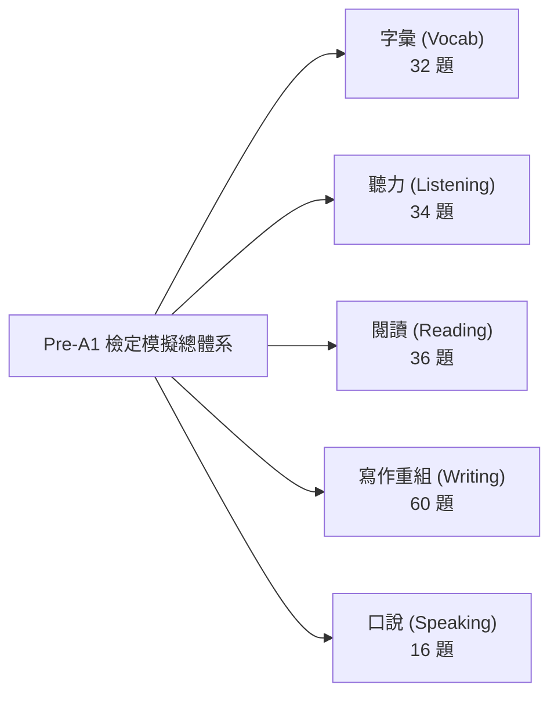

# Test My English Pre-A1 官方模擬測驗完整實戰備考指引與命題規格書
# (The Definitive Teacher & Student Pre-A1 Exam Handbook)

> **文件定位**：本手冊由霧臺國小教學團隊持續增補（Living Document），隨題庫擴充同步更新。旨在讓第一次接觸教育部「Test My English」Pre-A1 檢定的教師與學生，能清楚掌握檢定架構、能力指標邊界、考法題型、解題核心思維與經典類題精解，省去日後重新回顧全量題庫之成本。

---

## 一、 Pre-A1 測驗整體架構與核心指標 (Overview & Blueprint)

教育部「英語能力檢測平台」(Test My English) Pre-A1 級別係參照 CEFR 歐洲語言共同架構之 Pre-A1（約對應劍橋少兒英語 Cambridge YLE Starters 級別），為國小中低年級奠定英語初階能力之標準化測驗。

### 1. 測驗標準規格
- **正式模擬試卷**：30 題（聽力 15 題 ＋ 閱讀 15 題）。
- **作答時間**：35 分鐘。
- **合格門檻**：答對 21 題（得分率 $\ge 70\%$）。
- **專題特訓模式**：各面向 10 題 / 20 題模組化強化（聽力專項、閱讀專項、寫作句子重組專項）。

---

## 二、 五大能力面向題型代碼與命題思維

| 能力面向 | 官方子題型 | 題型代碼 | 命題哲學與評量目標 |
| :--- | :--- | :--- | :--- |
| **字彙 (Vocab)** | 看字選圖 / 看圖選字 / 聽音選圖 / 聽音選字 | `V-PIC`, `V-WORD` | 建立「聲音 ↔ 字母拼寫 ↔ 具象線稿語意」三位一體之直覺反射。 |
| **聽力 (Listening)** | 看圖選句 / 聽對話選圖 / 選正確回應 / 聽對話答題 | `L-SENT`, `L-DLG`, `L-RESP`, `L-CONV` | 評量生活日常問候、指令理解、場景關鍵字捕捉與語用回應（Pragmatics）。 |
| **閱讀 (Reading)** | 看圖選字 / 看圖選句 / 是非判斷 / 段落填空 | `R-TF`, `R-CLOZE`, `R-PASSAGE` | 評量生活短句理解、日常告示配合、短篇生活敘述（Diary, Notice, Invitation）之脈絡填空。 |
| **寫作 (Writing)** | 句子重組（答句重組 / 問句重組） | `W-SCRAMBLE` | 聚焦國小第 1～8 冊核心十大句型，透過立體磁吸積木手感理解語序（Word Order）與助動詞/be動詞配置。 |
| **口說 (Speaking)** | 單字朗讀 / 短句朗讀 / 長句朗讀 | `S-READ` | 評量自然發音連音、語調起伏、常見生活短語朗讀之流暢度。 |

---

## 三、 寫作專項：國小核心十大句型手冊 (Writing Scramble Master Guide)

本系統獨創之「彩色立體磁吸單字積木架 (3D Magnetic Word Blocks Rack)」，將抽象的文法重組轉化為具象的蒙特梭利式積木操作。以下為本題庫 60 題所涵蓋之十大核心句型解題心法：

### 句型 1：Wh- 疑問句型 (Wh- Questions)
- **結構通式**：`Wh-疑問詞 + be動詞 / 助動詞 + 主詞 + (動詞原形) ... ?`
- **常見疑問詞**：
  - `What`（事物、時間 `What time`、顏色 `What color`）
  - `Where`（地點空間）
  - `Who`（人物身分）
  - `How`（問候狀況、天氣 `How is the weather`、年齡 `How old`、數量 `How many`、價格 `How much`）
- **學生常見盲點**：容易漏掉 be 動詞或與主詞顛倒（如寫成 *What your name is?*）。
- **代表性類題試題**：
  - *題目*：看回答「My name is Leo.」，重組問句。
  - *給定字卡*：`is` / `name` / `your` / `What`
  - *標準解法*：疑問詞 `What` 放句首大寫 $\to$ 接 be 動詞 `is` $\to$ 所有格名詞 `your name` $\to$ 句末問號 `?`。
  - *正解*：`What is your name?`

---

### 句型 2：Be 動詞肯定句與否定句 (Be-verb Statements & Negatives)
- **結構通式**：
  - 肯定：`主詞 + am / is / are + 名詞 / 形容詞 / 介系詞片語 .`
  - 否定：`主詞 + am / is / are + not + 名詞 / 形容詞 / 介系詞片語 .`
- **主詞動詞一致性 (Subject-Verb Agreement)**：
  - `I` 搭配 `am`
  - `He / She / It / 單數名詞` 搭配 `is`
  - `We / You / They / 複數名詞` 搭配 `are`
- **代表性類題試題**：
  - *題目*：重組否定句「他不是醫生」。
  - *給定字卡*：`doctor` / `not` / `is` / `a` / `He`
  - *正解*：`He is not a doctor.`

---

### 句型 3：Be 動詞 Yes/No 問句與簡答 (Be-verb Yes/No Questions)
- **結構通式**：
  - 問句：`Am / Is / Are + 主詞 + 補語 ... ?`
  - 答句：`Yes, 主詞 + be動詞 .` / `No, 主詞 + be動詞 + not .`
- **核心思維**：被問 `Are you...?` 時，第一人稱回答轉為 `Yes, I am.`，切勿機械式照抄 `you are`。
- **代表性類題試題**：
  - *題目*：看回答「Yes, I am.」，重組問句。
  - *給定字卡*：`new` / `Are` / `student` / `you` / `a`
  - *正解*：`Are you a new student?`

---

### 句型 4：情態助動詞 Can 肯定、否定與疑問句 (Modal Verb Can)
- **結構通式**：
  - 肯定：`主詞 + can + 原形動詞 ... .`
  - 否定：`主詞 + cannot (can't) + 原形動詞 ... .`
  - 疑問：`Can + 主詞 + 原形動詞 ... ?`
- **核心思維**：`can` 後方**一律接動詞原形**，不受第三人稱單數加 `s` 影響；樂器前加 `the`（`play the piano`），球類前不加 `the`（`play basketball`）。
- **代表性類題試題**：
  - *題目*：重組肯定句「她會彈鋼琴」。
  - *給定字卡*：`piano` / `can` / `play` / `the` / `She`
  - *正解*：`She can play the piano.`

---

### 句型 5：喜好助動詞 Do/Does 句型 (Preferences with Like)
- **結構通式**：
  - 問句：`Do / Does + 主詞 + like + 受詞 ... ?`
  - 肯定：`主詞 + like / likes + 受詞 .`
  - 否定：`主詞 + do not / does not + like + 受詞 .`
- **核心思維**：遇到第三人稱單數時，疑問句使用 `Does`，動詞必須**打回原形 like**；否定句使用 `does not like`。
- **代表性類題試題**：
  - *題目*：看回答「No, she likes milk.」，重組問句。
  - *給定字卡*：`orange` / `juice` / `she` / `Does` / `like`
  - *正解*：`Does she like orange juice?`

---

### 句型 6：需求與想要句型 (Needs & Desires - Want / Need)
- **結構通式**：
  - `主詞 + want(s) + 名詞 / to + 原形動詞 ... .`
  - `What do you want for + 餐別?`
- **核心思維**：多個形容詞修飾同一名詞時，排序原則為「新舊 (new) 先於 顏色 (yellow)」$\to$ `a new yellow doll`。
- **代表性類題試題**：
  - *題目*：重組點餐禮貌句「請給我一個漢堡」。
  - *給定字卡*：`hamburger` / `a` / `please` / `want` / `I`
  - *正解*：`I want a hamburger, please.`

---

### 句型 7：方位介系詞句型 (Prepositions of Place)
- **四大核心介系詞**：
  - `in`（在內部，如 `in the pencil case`）
  - `on`（在表面上，如 `on the desk`）
  - `under`（在正下方，如 `under the chair`）
  - `next to`（在隔壁、相鄰，如 `next to the hospital`）
- **代表性類題試題**：
  - *題目*：看問句「Where is my ruler?」，重組答句。
  - *給定字卡*：`desk` / `is` / `on` / `It` / `big` / `the`
  - *正解*：`It is on the big desk.`

---

### 句型 8：現在進行式句型 (Present Continuous - be + V-ing)
- **結構通式**：
  - 肯定：`主詞 + am / is / are + V-ing + 受詞 / 地方片語 .`
  - 問句：`What + are / is + 主詞 + doing (right now)?`
- **代表性類題試題**：
  - *題目*：重組進行式「女孩正在房間裡聽音樂」。
  - *給定字卡*：`room` / `listening` / `her` / `music` / `in` / `She` / `is` / `to`
  - *正解*：`She is listening to music in her room.`

---

### 句型 9：存在句與數量句型 (There is/are & How many)
- **結構通式**：
  - 單數存在：`There is + a / an + 單數名詞 + 地方片語 .`
  - 複數存在：`There are + 複數名詞 / 數量詞 + 地方片語 .`
  - 數量問句：`How many + 複數名詞 + do you have?`
- **代表性類題試題**：
  - *題目*：重組存在句「大樹上有三隻鳥」。
  - *給定字卡*：`tree` / `birds` / `three` / `big` / `are` / `in` / `There` / `the`
  - *正解*：`There are three birds in the big tree.`（注意：英文習慣「鳥在樹枝間築巢棲息」使用介系詞 `in the tree`）

---

### 句型 10：祈使句與提議句型 (Imperatives & Suggestions)
- **結構通式**：
  - 提議句：`Let's + 原形動詞 + (受詞) + (副詞/副詞片語) .`
  - 肯定祈使句：`(Please) + 原形動詞 + 受詞 + (, please) .`
  - 否定祈使句：`Do not (Don't) + 原形動詞 + ... .`
- **代表性類題試題**：
  - *題目*：重組提議句「放學後我們一起去打籃球吧」。
  - *給定字卡*：`school` / `play` / `after` / `basketball` / `Let's`
  - *正解*：`Let's play basketball after school.`

---

## 四、 本手冊維護與後續章節推進路徑 (Roadmap)

本手冊將隨後續開發，按以下規劃持續推進：
1. **第伍章：閱讀面向生活情境短文題型與篇章填空答題心法**（隨 R-CLOZE 題庫擴充同步紀錄）
2. **第陸章：聽力日常溝通問答（L-RESP）與言談理解（L-CONV）關鍵應答句典**
3. **第柒章：字彙三位一體圖文音對應表與高頻核心 200 詞字表**
4. **第捌章：口說 AI 語音即時評測評分規準 (Rubrics) 與常見發音盲點指引**
