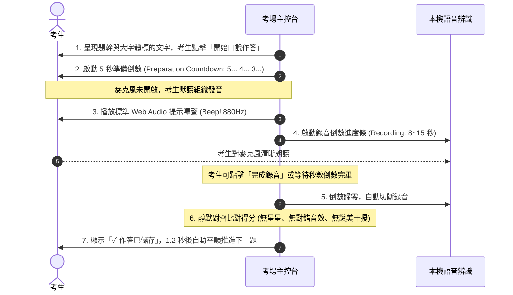
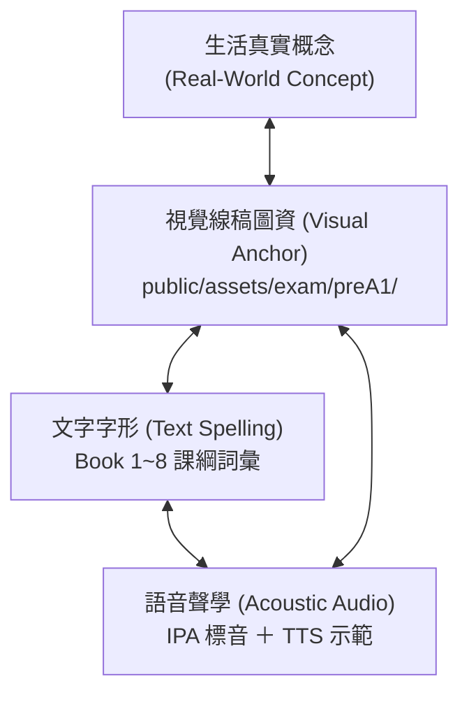
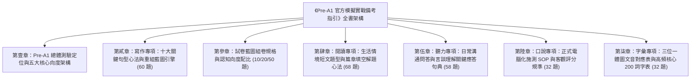

# Test My English Pre-A1 官方模擬測驗完整實戰備考指引與命題規格書
# (The Definitive Teacher & Student Pre-A1 Exam Handbook)

> **文件定位**：本手冊由霧臺國小教學團隊持續增補（Living Document），隨題庫擴充同步更新。旨在讓第一次接觸教育部「Test My English」Pre-A1 檢定的教師與學生，能清楚掌握檢定架構、能力指標邊界、考法題型、解題核心思維與經典類題精解，省去日後重新回顧全量題庫之成本。

---

## 一、 Pre-A1 測驗整體架構與核心指標 (Overview & Blueprint)

教育部「英語能力檢測平台」(Test My English) Pre-A1 級別係參照 CEFR 歐洲語言共同架構之 Pre-A1（約對應劍橋少兒英語 Cambridge YLE Starters 級別），為國小中低年級奠定英語初階能力之標準化測驗。


### 1. 測驗標準規格
- **正式模擬試卷**：30 題（聽力 15 題 ＋ 閱讀 15 題）。
- **作答時間**：35 分鐘。
- **合格門檻**：答對 21 題（得分率 $\ge 70\%$）。
- **專題特訓模式**：各面向 10 題 / 20 題模組化強化（聽力專項、閱讀專項、寫作句子重組專項）。

---

## 二、 五大能力面向題型代碼與命題思維

| 能力面向 | 官方子題型 | 題型代碼 | 命題哲學與評量目標 |
| :--- | :--- | :--- | :--- |
| **字彙 (Vocab)** | 看字選圖 / 看圖選字 / 聽音選圖 / 聽音選字 | `V-PIC`, `V-WORD` | 建立「聲音 ↔ 字母拼寫 ↔ 具象線稿語意」三位一體之直覺反射。 |
| **聽力 (Listening)** | 看圖選句 / 聽對話選圖 / 選正確回應 / 聽對話答題 | `L-SENT`, `L-DLG`, `L-RESP`, `L-CONV` | 評量生活日常問候、指令理解、場景關鍵字捕捉與語用回應（Pragmatics）。 |
| **閱讀 (Reading)** | 看圖選字 / 看圖選句 / 是非判斷 / 段落填空 | `R-TF`, `R-CLOZE`, `R-PASSAGE` | 評量生活短句理解、日常告示配合、短篇生活敘述（Diary, Notice, Invitation）之脈絡填空。 |
| **寫作 (Writing)** | 句子重組（答句重組 / 問句重組） | `W-SCRAMBLE` | 聚焦國小第 1～8 冊核心十大句型，透過立體磁吸積木手感理解語序（Word Order）與助動詞/be動詞配置。 |
| **口說 (Speaking)** | 單字朗讀 / 短句朗讀 / 長句朗讀 | `S-READ` | 評量自然發音連音、語調起伏、常見生活短語朗讀之流暢度。 |

---

## 三、 寫作專項：國小核心十大句型手冊 (Writing Scramble Master Guide)

本系統獨創之「彩色立體磁吸單字積木架 (3D Magnetic Word Blocks Rack)」，將抽象的文法重組轉化為具象的蒙特梭利式積木操作。以下為本題庫 60 題所涵蓋之十大核心句型解題心法：

### 句型 1：Wh- 疑問句型 (Wh- Questions)
- **結構通式**：`Wh-疑問詞 + be動詞 / 助動詞 + 主詞 + (動詞原形) ... ?`
- **常見疑問詞**：
  - `What`（事物、時間 `What time`、顏色 `What color`）
  - `Where`（地點空間）
  - `Who`（人物身分）
  - `How`（問候狀況、天氣 `How is the weather`、年齡 `How old`、數量 `How many`、價格 `How much`）
- **學生常見盲點**：容易漏掉 be 動詞或與主詞顛倒（如寫成 *What your name is?*）。
- **代表性類題試題**：
  - *題目*：看回答「My name is Leo.」，重組問句。
  - *給定字卡*：`is` / `name` / `your` / `What`
  - *標準解法*：疑問詞 `What` 放句首大寫 $\to$ 接 be 動詞 `is` $\to$ 所有格名詞 `your name` $\to$ 句末問號 `?`。
  - *正解*：`What is your name?`

---

### 句型 2：Be 動詞肯定句與否定句 (Be-verb Statements & Negatives)
- **結構通式**：
  - 肯定：`主詞 + am / is / are + 名詞 / 形容詞 / 介系詞片語 .`
  - 否定：`主詞 + am / is / are + not + 名詞 / 形容詞 / 介系詞片語 .`
- **主詞動詞一致性 (Subject-Verb Agreement)**：
  - `I` 搭配 `am`
  - `He / She / It / 單數名詞` 搭配 `is`
  - `We / You / They / 複數名詞` 搭配 `are`
- **代表性類題試題**：
  - *題目*：重組否定句「他不是醫生」。
  - *給定字卡*：`doctor` / `not` / `is` / `a` / `He`
  - *正解*：`He is not a doctor.`

---

### 句型 3：Be 動詞 Yes/No 問句與簡答 (Be-verb Yes/No Questions)
- **結構通式**：
  - 問句：`Am / Is / Are + 主詞 + 補語 ... ?`
  - 答句：`Yes, 主詞 + be動詞 .` / `No, 主詞 + be動詞 + not .`
- **核心思維**：被問 `Are you...?` 時，第一人稱回答轉為 `Yes, I am.`，切勿機械式照抄 `you are`。
- **代表性類題試題**：
  - *題目*：看回答「Yes, I am.」，重組問句。
  - *給定字卡*：`new` / `Are` / `student` / `you` / `a`
  - *正解*：`Are you a new student?`

---

### 句型 4：情態助動詞 Can 肯定、否定與疑問句 (Modal Verb Can)
- **結構通式**：
  - 肯定：`主詞 + can + 原形動詞 ... .`
  - 否定：`主詞 + cannot (can't) + 原形動詞 ... .`
  - 疑問：`Can + 主詞 + 原形動詞 ... ?`
- **核心思維**：`can` 後方**一律接動詞原形**，不受第三人稱單數加 `s` 影響；樂器前加 `the`（`play the piano`），球類前不加 `the`（`play basketball`）。
- **代表性類題試題**：
  - *題目*：重組肯定句「她會彈鋼琴」。
  - *給定字卡*：`piano` / `can` / `play` / `the` / `She`
  - *正解*：`She can play the piano.`

---

### 句型 5：喜好助動詞 Do/Does 句型 (Preferences with Like)
- **結構通式**：
  - 問句：`Do / Does + 主詞 + like + 受詞 ... ?`
  - 肯定：`主詞 + like / likes + 受詞 .`
  - 否定：`主詞 + do not / does not + like + 受詞 .`
- **核心思維**：遇到第三人稱單數時，疑問句使用 `Does`，動詞必須**打回原形 like**；否定句使用 `does not like`。
- **代表性類題試題**：
  - *題目*：看回答「No, she likes milk.」，重組問句。
  - *給定字卡*：`orange` / `juice` / `she` / `Does` / `like`
  - *正解*：`Does she like orange juice?`

---

### 句型 6：需求與想要句型 (Needs & Desires - Want / Need)
- **結構通式**：
  - `主詞 + want(s) + 名詞 / to + 原形動詞 ... .`
  - `What do you want for + 餐別?`
- **核心思維**：多個形容詞修飾同一名詞時，排序原則為「新舊 (new) 先於 顏色 (yellow)」$\to$ `a new yellow doll`。
- **代表性類題試題**：
  - *題目*：重組點餐禮貌句「請給我一個漢堡」。
  - *給定字卡*：`hamburger` / `a` / `please` / `want` / `I`
  - *正解*：`I want a hamburger, please.`

---

### 句型 7：方位介系詞句型 (Prepositions of Place)
- **四大核心介系詞**：
  - `in`（在內部，如 `in the pencil case`）
  - `on`（在表面上，如 `on the desk`）
  - `under`（在正下方，如 `under the chair`）
  - `next to`（在隔壁、相鄰，如 `next to the hospital`）
- **代表性類題試題**：
  - *題目*：看問句「Where is my ruler?」，重組答句。
  - *給定字卡*：`desk` / `is` / `on` / `It` / `big` / `the`
  - *正解*：`It is on the big desk.`

---

### 句型 8：現在進行式句型 (Present Continuous - be + V-ing)
- **結構通式**：
  - 肯定：`主詞 + am / is / are + V-ing + 受詞 / 地方片語 .`
  - 問句：`What + are / is + 主詞 + doing (right now)?`
- **代表性類題試題**：
  - *題目*：重組進行式「女孩正在房間裡聽音樂」。
  - *給定字卡*：`room` / `listening` / `her` / `music` / `in` / `She` / `is` / `to`
  - *正解*：`She is listening to music in her room.`

---

### 句型 9：存在句與數量句型 (There is/are & How many)
- **結構通式**：
  - 單數存在：`There is + a / an + 單數名詞 + 地方片語 .`
  - 複數存在：`There are + 複數名詞 / 數量詞 + 地方片語 .`
  - 數量問句：`How many + 複數名詞 + do you have?`
- **代表性類題試題**：
  - *題目*：重組存在句「大樹上有三隻鳥」。
  - *給定字卡*：`tree` / `birds` / `three` / `big` / `are` / `in` / `There` / `the`
  - *正解*：`There are three birds in the big tree.`（注意：英文習慣「鳥在樹枝間築巢棲息」使用介系詞 `in the tree`）

---

### 句型 10：祈使句與提議句型 (Imperatives & Suggestions)
- **結構通式**：
  - 提議句：`Let's + 原形動詞 + (受詞) + (副詞/副詞片語) .`
  - 肯定祈使句：`(Please) + 原形動詞 + 受詞 + (, please) .`
  - 否定祈使句：`Do not (Don't) + 原形動詞 + ... .`
- **代表性類題試題**：
  - *題目*：重組提議句「放學後我們一起去打籃球吧」。
  - *給定字卡*：`school` / `play` / `after` / `basketball` / `Let's`
  - *正解*：`Let's play basketball after school.`

---

## 四、 閱讀專項：生活情境短文題型與篇章填空解題心法 (Reading Master Guide)

本系統閱讀題庫擴充至 **68 題**，全面涵蓋教育部國小 1～8 冊高頻詞彙與常見真實情境。以下解構五大閱讀子面向、非重點超綱字註解規範與核心破題策略：

### 1. 閱讀能力指標與五大子題型架構 (68 題全量)

| 子題型代碼 | 官方題型名稱 | 題數 | 評量目標與題型特徵 |
| :--- | :--- | :--- | :--- |
| `read-pic2word` (V-PIC) | 看圖選字 | 8 題 | 生活場所、文具、教室設備等具象線稿與單字直覺對應。 |
| `read-pic2sent` (G-CTX) | 看圖選句 | 8 題 | 結合進行式、存在句與主詞動作之生活情境整句理解。 |
| `read-truefalse` (R-TF) | 是非判斷 | 10 題 | 2～3 句微型短文之資訊對照與真偽辨識（True / False）。 |
| `read-cloze` (R-CLOZE) | 段落填空 | 18 題 | 具備完整脈絡的生活短文（40～60 字），依動詞搭配與語意選出正確名詞/形容詞。 |
| `read-passage` (R-COMP) | 篇章閱讀理解 | 24 題 | 6 大生活篇章（每篇 4 題組題）：涵蓋霧臺山林生活、校園失物招領告示、生日邀請函、寵物日記、晨間好習慣、四季天氣。 |

---

### 2. 嚴謹課綱範圍與文末星號 (*) 註解規範 (Footnote Policy)

本系統閱讀篇章命題嚴守三大原則：
1. **核心骨幹嚴守課綱**：句型與主體單字 100% 來自國小英語 1～8 冊核心詞庫（家庭、學校、動物、食物、日常作息、方位與顏色）。
2. **非核心情境超綱字文末附註**：為豐富文章真實感（如告示格式、部落文化），篇章中出現之少數非核心單字，**一律於文末以星號 (*) 提供清晰繁體中文註解**，例如：
   ```text
   * stone slab house: 石板屋
   * boiled millet cake: 水煮小米糕
   * lost and found: 失物招領
   * invitation: 邀請函
   * strawberry: 草莓
   * fever: 發燒
   ```
3. **消除應考恐慌**：學生在答題時可隨時參照文末註解，評量重心回歸「閱讀理解與資訊擷取」本質，而非背誦罕見生詞。

---

### 3. 短文填空 (Cloze) 破題三部曲

短文填空考驗學生在微型語境中提取正確詞彙的能力，指導學生依照以下「三部曲」作答：

- **第一步：看動詞與固定搭配 (Collocation)**：
  - 空格前若有 `drinks a glass of ____`，空格必為可飲用液體（如 `milk`, `water`），直接排除固體食物或文具。
  - 空格前若有 `play the ____`，後接樂器（如 `piano`）；若為 `play ____` 不加 the，後接球類（如 `basketball`）。
  - 空格前若有 `brush your ____`，固定搭配為牙齒（`teeth`）。
- **第二步：看冠詞與單複數 (Article & Number)**：
  - 空格前有 `an ____`，表示答案必須為**母音發音開頭之單數名詞**（如 `umbrella`, `apple`, `eraser`），子音開頭的 `pencil`, `ruler` 可直接排除。
  - 空格前有 `five yellow ____`，答案必為複數名詞（如 `ducks`）。
- **第三步：通讀整句檢查生活常理**：
  - 代入選項後朗讀一次，確保前後文意通順符合生活邏輯。

---

### 4. 篇章閱讀理解 (Reading Comprehension) 實戰定位策略 (Scan & Locate)

面對 60～100 字的生活短文、告示或邀請函，學生不需逐字死背，應掌握「關鍵字定位法」：

1. **問句疑問詞引導搜尋路徑**：
   - 遇到 `What time`：目光直接掃描文章中的**數字與時間標記**（如 `from 2:00 PM to 5:00 PM`、`seven o'clock`）。
   - 遇到 `Where`：目光掃描**介系詞短語與地點名詞**（如 `outside their stone slab house`、`near the gym`、`in the library`）。
   - 遇到 `Who / Whose`：尋找大寫專有名詞與所有格（如 `Kevin's birthday party`、`Amy's cat`）。
   - 遇到 `Why`：尋找原因連接詞或動詞目的（如 `helps students study well`、`gives the body strong energy`）。
2. **告示與邀請函特徵區塊快讀**：
   - 標題（Title）：辨識活動主題（LOST AND FOUND / BIRTHDAY PARTY）。
   - 欄位（When, Where, Activities）：一對一核對題目選項。
   - 聯絡與期限（Contact / Reply deadline）：注意 `before December 8th` 等時間陷阱。

---

### 5. 代表性經典題組解析

#### 【經典範例一：在地文化生活短文】
> **篇章內容**：
> Leo and his sister, Maya, live in Wutai. Today is Sunday, and the weather is sunny and warm.
> In the morning, they help their grandfather in the vegetable garden. They pick fresh red tomatoes and green beans.
> In the afternoon, they sit outside their stone slab house. Grandfather tells them stories about the mountains while they eat sweet boiled millet cakes.
> Leo loves his mountain home very much.
> 
> \* stone slab house: 石板屋  
> \* boiled millet cake: 水煮小米糕  
> \* fresh: 新鮮的  

- **類題 1**：What is the weather like in Wutai today?
  - 正解：`(A) It is sunny and warm.`
  - 誘答陷阱：`(B) It is cold and rainy.`（雨天為常見反向誘答）
  - 解題策略：直接定位第一段第二句「the weather is sunny and warm」。
- **類題 2**：Where do the children sit in the afternoon?
  - 正解：`(A) Outside their stone slab house`
  - 解題策略：利用時間副詞「In the afternoon」精確定位到第三段第一句。

---

## 五、 聽力專項：日常溝通問答（L-RESP）與言談理解（L-CONV）關鍵應答句典 (Listening Master Guide)

本系統聽力題庫擴充至 **58 題**，旨在評量學生在生活日常情境中的真實溝通語用（Pragmatics）與關鍵訊息捕捉能力。以下解構四大子題型、高頻日常對話句典與聽力破題心法：

### 1. 聽力能力指標與四大子題型架構 (58 題全量)

| 子題型代碼 | 官方題型名稱 | 題數 | 評量目標與聽力特徵 |
| :--- | :--- | :--- | :--- |
| `listen-pic2sent` (L-SENT) | 看圖選句 | 7 題 | 結合線稿插圖與單句語音，檢驗動作、顏色、交通與物品方位理解。 |
| `listen-dlg2pic` (L-DLG) | 聽對話選圖 | 7 題 | 聽取 2 輪日常生活對話，辨識說話者想去的場所（圖書館/動物園）或購買物品。 |
| `listen-resp` (L-QA) | 選正確回應 | 22 題 | 聽取日常生活問句或社交對話，在 6 組選項中選出最合適、合乎禮儀之應答句。 |
| `listen-conv-qa` (L-CONV) | 聽對話答題 | 22 題 | 聽取 2～3 輪真實情境對話與末尾問題，捕捉時間、金額、地點、職業或事件主旨。 |

---

### 2. 日常情境對話應答 (L-RESP) 七大高頻語用語境句典

在 Pre-A1 聽力應答中，學生常因文法死背而忽略**真實語用語境（Pragmatics）**。以下為本題庫 22 題所涵蓋之標準應答句典：

#### ① 問候與初次見面 (Greetings)
- **聽力輸入**：`Nice to meet you, Linda.` / `How are you doing today?`
- **標準正解**：`Nice to meet you, too.` / `I'm fine, thank you.`
- **常犯陷阱**：回答年齡（*I am ten years old.*）或方位（*It is in your bag.*）。

#### ② 感謝與客氣應答 (Gratitude)
- **聽力輸入**：`Thank you for your help, Peter.`
- **標準正解**：`You are welcome.` / `My pleasure.`
- **常犯陷阱**：機械式回答打招呼句（*I am fine, thanks.*）。

#### ③ 道歉與包容安慰 (Apologies & Reassurance)
- **聽力輸入**：`I am so sorry I broke your yellow crayon.`
- **標準正解**：`That's all right. Don't worry.` / `No problem.`
- **常犯陷阱**：回答顏色喜好（*I like red crayons.*）。

#### ④ 請求與樂意協助 (Requests & Willingness)
- **聽力輸入**：`Can you help me carry this heavy box, Andy?` / `Can I borrow your eraser?`
- **標準正解**：`Sure, no problem!` / `Sure! Here you are.`
- **常犯陷阱**：直接回答所有格或身分（*It is my brother's.*）。

#### ⑤ 提議與邀約 (Suggestions with Let's)
- **聽力輸入**：`It is a beautiful sunny day. Let's go swimming!`
- **標準正解**：`Great idea! Let's go!`
- **常犯陷阱**：以否定句回答身分（*No, I am not a teacher.*）。

#### ⑥ 身體狀況關心 (Health & Well-being)
- **聽力輸入**：`What's wrong, Andy? You look very tired.`
- **標準正解**：`I have a headache and a fever.`
- **常犯陷阱**：誤聽為喜好（*I like to eat apples.*）。

#### ⑦ 選擇性問句 (Choices with Or)
- **聽力輸入**：`Do you like bananas or papayas, Lisa?`
- **標準正解**：`I like bananas. They are sweet.`
- **重要考點**：選擇性問句（A or B）**絕對不能回答 Yes 或 No**，必須明確回答偏好選項。

---

### 3. 言談理解 (L-CONV) 聽力捕捉心法

面對長度 25～40 字之英語對話，引導學生運用「三步捕捉法」：

1. **第一步：聽第一句捕捉角色關係與場景**：
   - 聽到 `Mom, I am hungry after practice...` $\to$ 建立「家庭廚房/點心」場景。
   - 聽到 `Excuse me, where can I find books about animals?` $\to$ 建立「圖書館借書」場景。
2. **第二步：注意轉折詞與關鍵協商 (Negotiation)**：
   - 在約定時間或偏好題中，常出現初次提議被修正的情節：
     - A: `How about eight o'clock?`
     - B: `Eight is a bit early. Can we meet at eight thirty?`
     - A: `Sure! Eight thirty is perfect.`
     - **關鍵**：最後確認的 `eight thirty` 才是正解，切勿聽到第一個數字 `eight o'clock` 就搶答。
3. **第三步：聽清最後 Question 的疑問焦點**：
   - `What does the boy want to drink?` $\to$ 聚焦飲料名詞（`milk`）。
   - `Where was the pencil?` $\to$ 聚焦介系詞片語（`inside her English textbook`）。
   - `What does Amy's mother do?` $\to$ 聚焦職業單字（`nurse`）。

---

### 4. 代表性經典對話試題解構

#### 【經典範例：時間約定協商題】
> **對話音檔**：  
> Girl: What time should we meet at the school gate on Saturday morning, Tom?  
> Tom: How about eight o'clock?  
> Girl: Eight is a bit early. Can we meet at eight thirty?  
> Tom: Sure! Eight thirty is perfect.  
> Question: What time will they meet on Saturday?  

- **選項**：
  - `(A) At eight thirty`（正解）
  - `(B) At eight o'clock`（誘答：男孩一開始提議但被否決的時間）
  - `(C) At nine o'clock`（誘答：常見整點時間干擾）
  - `(D) At seven thirty`（誘答：提早一小時的時間干擾）
- **教學解析**：
  本題測驗真實對話中的協商歷程。Tom 先提議 8:00，女孩覺得太早提議改為 8:30，最後 Tom 以「Sure! Eight thirty is perfect.」達成共識。學生需聽完全程，選出最終約定時間 (A)。

---

## 六、 口說專項：正式電腦化施測標準作業程序（SOP）與客觀評分規準 (Speaking Standard SOP & Rubrics)

口說測驗擴充至 **32 題**，嚴格依循標準線上語言測驗（Computer-Based Testing, CBT）規範，建立客觀中立、零即時回饋干擾之標準化考場架構：

### 1. 三大口說子題型與評量規準 (32 題全量)

| 子題型代碼 | 官方題型名稱 | 題數 | 準備時間 | 錄音時間 | 評量目標與能力指標 |
| :--- | :--- | :---: | :---: | :---: | :--- |
| `speak-word` (S-WORD) | 單字片語朗讀 | 10 題 | 5 秒 | 8 秒 | 自然發音（Phonics）、單雙母音、字首子音咬字清晰度（如 orange, bicycle, rabbit）。 |
| `speak-short` (S-SENT) | 實用短句朗讀 | 12 題 | 5 秒 | 10 秒 | 日常實用問句與直述句（4~6 字），評量 Wh-問句句尾降調、Yes/No 問句升調與流暢度。 |
| `speak-long` (S-READ) | 篇章敘述長句朗讀 | 10 題 | 5 秒 | 15 秒 | 連貫敘述長句（8~14 字），評量意群斷句（Sense Groups）、連音（Liaison）與語音節奏感。 |

---

### 2. 標準線上語言測驗施測作業程序 (Computer-Based Exam SOP)

為維持正式考試的中立性與專注度，本系統嚴格區隔「日常練習學習」與「正式測驗考場」：



---

### 3. 客觀雙軌文本對齊評分機制 (Objective Dual-Track Scoring)

針對國小學童（尤其低年級稚嫩童音與原鄉學童口音）之聲學特徵，系統採用客戶端純原生零延遲之**雙軌文本對齊計分演算法**：

1. **核心關鍵詞涵蓋率 (Keyword Recall Ratio, 60% 權重)**：
   - 將標的句與考生錄音文字進行符號濾除與小寫標準化，提取具備語意之關鍵字（Content Words）。
   - 檢驗考生是否完整讀出核心名詞、動詞與形容詞，避免漏字。
2. **編輯距離容錯率 (Levenshtein Distance Ratio, 40% 權重)**：
   - 針對單字之音素微差（例如 child-pitch 高亢造成的單一字母 ASR 誤判），計算字串編輯距離。
3. **合格判定門檻 (Passing Threshold)**：
   - 綜合匹配率 $\ge 40\%$ 即判定為該題通過合格（正解記分）。
   - 測驗過程中**全程靜默記錄**，所有得分與語音辨識紀錄統一收錄於交卷後的「成績診斷報告書」中。

---

## 七、 字彙專項：三位一體圖文音對應表與高頻核心 200 詞字表 (The Core 200 Vocabulary Triad Master Guide)

在 Pre-A1 英語初階檢定中，字彙是聽、說、讀、寫四大能力的共同基石。本系統奠基於「**三位一體直覺對應學習法**」（Triad Learning Model），擺脫傳統死記中文翻譯的低效模式：



---

### 1. 三位一體學習法之三大核心支柱

1. **視覺錨點 (Visual Anchor)**：
   - 採用 136 幅單一主體、極致簡約、高辨識度的黑白手繪線稿（如 `public/assets/exam/preA1/cat.svg`、`bicycle.svg`）。
   - 杜絕背景雜訊干擾，讓學童大腦直接將圖像輪廓與語義概念直接錨定。
2. **文字字形 (Text Orthography)**：
   - 嚴格鎖定教育部 Pre-A1 考綱與翰林《Here We Go》第 1～8 冊核心詞彙。
   - 強化字首字母、字尾子音（如 -t, -k, -d, -s）之拼字形體辨識。
3. **語音聲學 (Acoustic Audio)**：
   - 標記權威國際音標（IPA），結合瀏覽器高擬真 Web SpeechSynthesis 示範發音。
   - 建立「見字能讀、聽音能辨」的自然發音直覺反射。

---

### 2. 十二大生活情境主題核心 204 詞全量總覽庫

本字表由 [`src/data/exam/tmePreA1VocabList.js`](file:///c:/Users/user/.gemini/antigravity/scratch/wutaivocab/src/data/exam/tmePreA1VocabList.js) 統一管轄，全量對齊 12 大生活領域：

| 主題領域 | 詞數 | 代表核心詞彙 (精選) | 視覺圖資錨點範例 | 評量向度與核心考點 |
| :--- | :---: | :--- | :--- | :--- |
| **① 數字與時間** | 18 詞 | one ~ ten, morning, afternoon, night, Sunday, Saturday, weekend, time, clock | `clock.png` | 基數詞拼字（two vs three）、問候語時間點（morning vs night）、時間問句應答。 |
| **② 顏色與外貌形容詞** | 20 詞 | red, blue, yellow, green, orange, pink, purple, black, white, brown; big, small, tall, short, happy, sad, hot, cold, warm | `orange.svg` | 物件特徵修飾（a red apple）、天氣冷熱感知（cold and rainy）、情緒感受表達。 |
| **③ 動物世界** | 20 詞 | dog, cat, rabbit, bear, bird, duck, pig, fish, elephant, monkey, tiger, lion, horse, sheep, cow, frog, snake, mouse, spider, hippo | `dog.svg`, `rabbit.svg`, `elephant.svg` | 動物名稱看圖辨識、複數規則與不規則變化、常態生活情境動作（The dog wags its tail）。 |
| **④ 校園生活與文具** | 18 詞 | school, teacher, student, book, pen, pencil, eraser, ruler, desk, chair, bag, computer, blackboard, crayon, glue, scissors, paper, box | `pen.svg`, `pencil.svg`, `eraser.svg`, `desk.svg` | 課堂實用文具借用（Can I borrow your...?）、教室設施方位（under the desk）。 |
| **⑤ 美味飲食** | 22 詞 | apple, banana, orange, cake, bread, cookie, pizza, milk, water, juice, tea, cheese, tomato, carrot, sandwich, hamburger, rice, noodles, candy, chocolate, chicken | `apple.svg`, `bread.svg`, `pizza.svg`, `milk.svg` | 點心偏好表達（I like... / Do you want...?）、可數與不可數名詞感官建立（some water, two apples）。 |
| **⑥ 交通工具** | 10 詞 | bus, car, train, boat, plane, bicycle, truck, motorcycle, taxi, ship | `bus.svg`, `car.svg`, `bicycle.svg`, `train.svg` | 搭乘與騎乘動詞搭配（ride a bicycle, take a bus, drive a car）、公共交通工具辨識。 |
| **⑦ 家庭生活與場所** | 18 詞 | bed, sofa, table, lamp, door, window, cup, plate, house, kitchen, garden, park, zoo, library, hospital, supermarket, bookstore, beach | `bed.png`, `table.png`, `park.svg`, `hospital.png` | 家庭居所家具方位、社區重要公眾設施（借書去 library、看病去 hospital）。 |
| **⑧ 自然與天氣** | 16 詞 | sun, moon, star, cloud, rain, tree, flower, grass, mountain, river, sea, rainbow, snowman, sky, umbrella, wind | `sun.png`, `rain.png`, `mountain.png`, `tree.png` | 大自然景物特徵、天氣問答應答（It is sunny/rainy）、四季氣候感知。 |
| **⑨ 身體部位與五官** | 14 詞 | eye, ear, nose, mouth, hand, foot, arm, leg, hair, face, teeth, head, smile, heart | `eye.png`, `hand.png`, `ear.png`, `nose.png` | 五官與肢體指令（Touch your nose, Wash your hands）、單複數型態（foot $\to$ feet, tooth $\to$ teeth）。 |
| **⑩ 衣物與配件** | 12 詞 | hat, cap, coat, jacket, dress, skirt, pants, shirt, sock, shoe, glasses, watch | `hat.svg`, `cap.svg`, `jacket.svg`, `shoe.svg` | 穿著搭配動詞（Put on your warm coat / wear sneakers）、成雙成對名詞型態（glasses, pants, socks）。 |
| **⑪ 休閒運動與動作動詞** | 22 詞 | read, draw, listen, sing, eat, drink, sleep, swim, cook, wash, brush, climb, ride, play; ball, kite, robot, doll, soccer, baseball, piano, guitar | `action_swim.png`, `action_cook.png`, `piano.png` | 進行式與能力問句（He can swim / She is playing the piano）、球類運動與樂器動詞搭配。 |
| **⑫ 人物、家庭與職業** | 14 詞 | father, mother, brother, sister, friend, boy, girl, baby; doctor, nurse, cook, farmer, pilot, police officer | `doctor.png`, `nurse.png`, `teacher.png`, `cook.png` | 家庭成員稱謂、身分確認問句（Who is he?）、常見社會職業與工作場景對照。 |

---

### 3. 字彙題型三大命題邏輯與排他破題心法

在 Pre-A1 字彙專項的 32 題測驗中，涵蓋三大考法：

1. **看字選圖 (`vocab-word2pic`)**：
   - 題幹呈現英文單字（如 `bicycle`），選項呈現四張單純線稿（腳踏車、公車、轎車、火車）。
   - **破題心法**：直接提取字形首字母（`b-`）與字根特徵，迅速排除其他交通工具。
2. **看圖選字 (`vocab-pic2word`)**：
   - 題幹呈現單一線稿（如大象插圖），選項呈現四個英文單字（`elephant`, `monkey`, `rabbit`, `tiger`）。
   - **破題心法**：從視覺形象直接激發英文發音詞彙庫，對照首音音素 `/el-/`，即刻鎖定正確選項。
3. **聽音選字 (`vocab-audio2word`)**：
   - 題幹僅播放清晰單字發音音檔，選項呈現四個拼字相似單字（如 `desk`, `disk`, `duck`, `dusk`）。
   - **破題心法**：聚焦中間母音的長短音與子音尾音，如 `/e/` 與 `/ʌ/` 的精準聽辨。

---

## 八、 全書結語與實戰備考手冊完稿總結 (Complete Handbook Summary)

至此，《**Test My English Pre-A1 官方模擬與實戰備考指引**》正式全書完稿成冊！全書架構與題庫模組已達到最高標準之系統整合：



### 題庫資產全量盤點表 (Pre-A1 全量 250 題獨立模組)

| 測驗向度 | 題庫模組檔案 | 題數 | 核心評量亮點 |
| :--- | :--- | :---: | :--- |
| **字彙 (Vocab)** | `src/data/exam/tmePreA1Bank.js` | **32 題** | 看圖選字、看字選圖、聽音選字、聽音選圖，高頻 200 詞三位一體對應。 |
| **聽力 (Listening)** | `src/data/exam/tmePreA1ListeningBank.js` | **58 題** | 看圖選句、聽對話選圖、日常問答回應 (22題)、言談理解長對話 (22題)。 |
| **閱讀 (Reading)** | `src/data/exam/tmePreA1ReadingBank.js` | **68 題** | 看圖判斷、生活短文填空、6 篇生活真實情境篇章閱讀（含生詞星號註解規範）。 |
| **寫作 (Writing)** | `src/data/exam/tmePreA1ScrambleBank.js` | **60 題** | 國小 1～8 冊十大核心句型重組，支援彩色 3D 磁吸積木互動。 |
| **口說 (Speaking)** | `src/data/exam/tmePreA1SpeakingBank.js` | **32 題** | 單字朗讀、短句朗讀、長句朗讀，CBT 正式線上考場狀態機（5s準備+Beep+錄音靜默計分）。 |
| **合計** | **Pre-A1 全體系** | **250 題** | **全數通過 6 階段全自動無頭 Chrome 防回歸煙霧測試，零崩潰、零閃退！** |
